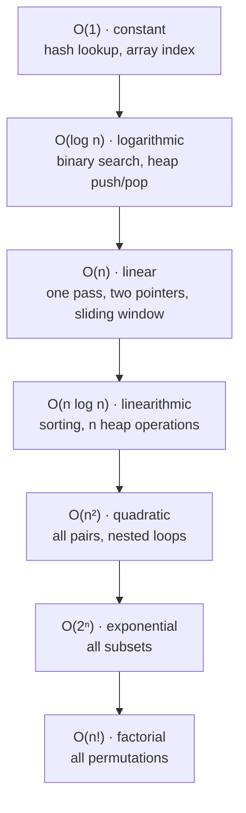

# Big-O in 15 Minutes

<div class="pattern-card" markdown>
**One-liner:** Big-O counts how the *number of steps* (time) and *memory cells* (space) grow as input size **n** grows, ignoring constants.

**⏱ Study time:** ~15 min
</div>

## The ladder

Faster algorithms are at the top. Each rung is dramatically slower than the one above for large *n*.



| n = | O(log n) | O(n) | O(n log n) | O(n²) | O(2ⁿ) |
|---|---|---|---|---|---|
| 10 | 3 | 10 | 33 | 100 | 1 024 |
| 1 000 | 10 | 1 000 | 10 000 | 1 000 000 | ∞ (≈ 10³⁰¹) |
| 1 000 000 | 20 | 10⁶ | 2·10⁷ | 10¹² ❌ | ∞ |

## Read the constraints → know the target

Interview and LeetCode problems tell you the target complexity through **the size limit on n**. Python handles roughly **10⁷ simple operations per second**.

| Constraint | Target complexity | Usual patterns |
|---|---|---|
| n ≤ 10 | O(n!) | Backtracking (permutations) |
| n ≤ 20 | O(2ⁿ) | Backtracking (subsets), bitmask DP |
| n ≤ 500 | O(n³) | 3-D DP, Floyd–Warshall |
| n ≤ 5 000 | O(n²) | 2-D DP, all-pairs |
| n ≤ 10⁶ | O(n log n) or O(n) | Sorting, heap, two pointers, sliding window, prefix sum |
| n ≥ 10⁹ / "follow-up: O(log n)" | O(log n) | Binary search (often on the answer) |

!!! tip "The single most useful habit"
    Before coding, look at the constraint and say *"n is 10⁵, so I need O(n log n) or better, which rules out the O(n²) brute force."* That one sentence already narrows down which patterns can work.

## Code shape → complexity

You can usually read the complexity straight off the *shape* of the code:

=== "Single loop"

    ```python
    for x in nums:          # n iterations
        total += x          # O(1) each
    ```
    <span class="cx time">O(n)</span>

=== "Nested loops"

    ```python
    for i in range(n):
        for j in range(i + 1, n):   # ~n²/2 pairs
            ...
    ```
    <span class="cx time">O(n²)</span>: the brute force most patterns replace.

=== "Two pointers"

    ```python
    l, r = 0, n - 1
    while l < r:            # each step moves l or r inward
        ...                 # → at most n steps total
    ```
    <span class="cx time">O(n)</span>, even when `l` and `r` are both inside one `while`.

=== "Halving"

    ```python
    while lo <= hi:
        mid = (lo + hi) // 2
        ...                 # discard half each time
    ```
    <span class="cx time">O(log n)</span>: n → n/2 → n/4 → … → 1 is log₂ n steps.

=== "Branching recursion"

    ```python
    def f(i):
        f(i + 1)            # take it
        f(i + 1)            # skip it
    ```
    <span class="cx time">O(2ⁿ)</span>: **branches^depth**. Memoise it and it becomes **states × work**.

## Two ideas you will need on every page

### Amortised cost

Sometimes one step is expensive but **the total is bounded**. In a monotonic stack, a single iteration can pop many elements, yet **each element is pushed once and popped at most once**, so all the pops together cost O(n). The sliding window is the same: `left` only ever moves forward, so the inner `while` runs at most *n* times in total.

!!! note "How to argue it"
    Don't multiply loop bounds. **Count how many times each element can be touched over the whole run.**

### Space includes the call stack

Recursion uses memory: **one stack frame per active call**.

- DFS on a balanced tree: O(log n) stack. On a skewed tree (a "linked list"): O(n).
- Backtracking: O(depth) for the recursion, plus the size of the output if you collect it.
- Python's default recursion limit is ~1000, so for deep inputs use an iterative version or `sys.setrecursionlimit`.

## Python operation costs that matter

| Operation | Cost | Watch out |
|---|---|---|
| `lst[i]`, `lst.append(x)`, `lst.pop()` | O(1) | |
| `lst.pop(0)`, `lst.insert(0, x)` | **O(n)** | use `collections.deque` → `popleft()` O(1) |
| `x in lst` | **O(n)** | use a `set` / `dict` → O(1) average |
| `x in s`, `d[k]` (set / dict) | O(1) average | |
| `lst[a:b]`, `s[a:b]` | O(b − a) | slicing **copies** |
| `sorted(lst)`, `lst.sort()` | O(n log n) | |
| `heapq.heappush / heappop` | O(log n) | min-heap; negate for max-heap |
| `heapq.heapify(lst)` | **O(n)** | cheaper than n pushes |
| `bisect.bisect_left(lst, x)` | O(log n) | `insort` is O(n) because of the shift |
| `s += ch` in a loop | O(n²) worst | collect in a list, `"".join(parts)` |

## Next

Continue to the [Pattern → Complexity Map](pattern-complexity-map.md), which ties every pattern to the rung of the ladder it lands on and explains why.
