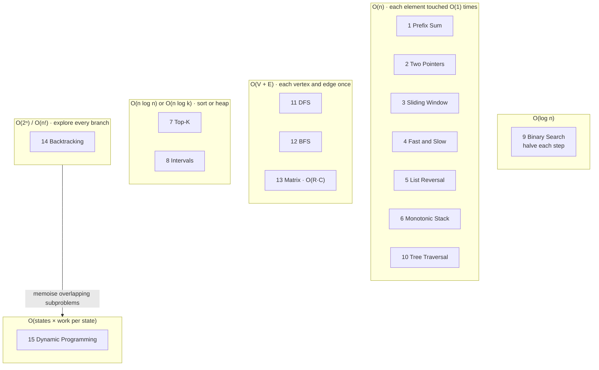

# Pattern → Complexity Map

Each pattern **lands on a predictable rung** of the Big-O ladder, and the reason is always a feature of *how the pattern moves through the data*. Learn the reason and you won't need to memorise the number.

## The full table

| # | Pattern | Time | Space | **Why**: the mechanism that sets the cost | Beats brute force |
|---|---|---|---|---|---|
| 1 | Prefix Sum | O(n) build, O(1) query | O(n) | one pass to build; a query is a subtraction | O(n) per query |
| 2 | Two Pointers | O(n) | O(1) | each pointer moves only inward, at most n steps total | O(n²) pairs |
| 3 | Sliding Window | O(n) | O(k) / O(Σ) | `right` and `left` each advance ≤ n times (amortised) | O(n²) or O(n·k) |
| 4 | Fast & Slow | O(n) | O(1) | fast catches slow within one lap | O(n) space with a `set` |
| 5 | In-place Reversal | O(n) | O(1) | each node's `next` is rewired once | O(n) space with a copy |
| 6 | Monotonic Stack | O(n) | O(n) | each element pushed once, popped ≤ once | O(n²) scan right |
| 7 | Top-K Elements | O(n log k) | O(k) | n pushes into a heap capped at size k | O(n log n) full sort |
| 8 | Overlapping Intervals | O(n log n) | O(n) | **sorting dominates**; the merge pass is O(n) | O(n²) pairwise |
| 9 | Modified Binary Search | O(log n) | O(1) | discard half the search space each step | O(n) linear scan |
| 10 | Binary Tree Traversal | O(n) | O(h) | visit each node once; stack depth = height *h* | — |
| 11 | DFS | O(V + E) | O(V) | `visited` set: each vertex expanded once, each edge scanned once | exponential without `visited` |
| 12 | BFS | O(V + E) | O(V) | same; the queue holds at most one "frontier ring" | — |
| 13 | Matrix Traversal | O(R·C) | O(R·C) | a grid is a graph with V = R·C, E ≤ 4V | — |
| 14 | Backtracking | O(bᵈ): 2ⁿ subsets, n! perms | O(d) + output | **branches^depth**; pruning cuts constants, not the worst case | — (the output is that big) |
| 15 | Dynamic Programming | O(states × transitions) | O(states), often O(1) rolling | each state is solved once and cached | O(2ⁿ) recursion |

## The five rules that cover most cases

!!! success "Memorise these five"
    1. **Each element touched a constant number of times → O(n).** Two pointers, sliding window, monotonic stack, reversal, fast and slow.
    2. **Halve the space each step → O(log n).** Binary search on an index *or* on the answer.
    3. **Sort first → O(n log n) floor.** Intervals, "sort + two pointers" (3Sum is O(n²) because it sorts once and then runs two pointers n times).
    4. **Visit every node/cell once with a `visited` set → O(V + E).** DFS, BFS, grids, trees.
    5. **Recursion tree: branches^depth. With memo: states × work per state.** This is the difference between backtracking and DP.

## Space cheatsheet

| Source of memory | Cost | Appears in |
|---|---|---|
| A few variables / pointers | O(1) | Two pointers, fast and slow, reversal, binary search |
| Hash map / set of seen items | O(n) or O(alphabet) | Prefix sum + map, sliding window counts |
| Heap of size k | O(k) | Top-K |
| Stack / queue | O(n) worst | Monotonic stack, BFS frontier, iterative DFS |
| Recursion depth | O(h) or O(depth) | Tree traversal, DFS, backtracking |
| DP table | O(states) → often O(1) with rolling variables | DP |
