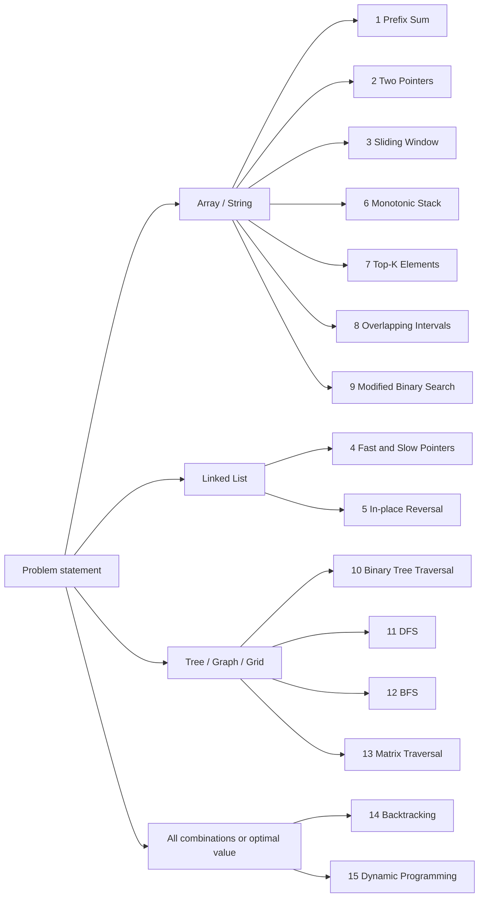

# LeetCode Patterns

**15 patterns solve the large majority of interview problems.** This site teaches each one in Python so you can *recognise* it from the problem statement, *picture* how it moves through the data, and *state its time and space complexity* without thinking twice.

It follows the 15 patterns from Ashish Pratap Singh's video
[*LeetCode was HARD until I Learned these 15 Patterns*](https://www.youtube.com/watch?v=DjYZk8nrXVY)
([article](https://blog.algomaster.io/p/15-leetcode-patterns)), expanded with diagrams, tested code and a complexity analysis for every pattern.

!!! abstract "How to learn this in 2–3 hours"
    Follow the [Study Plan](study-plan.md). Read the [Big-O primer](complexity/big-o-primer.md) first (15 min), then work through the patterns in order (~8–10 min each), and finish with the [decision tree](which-pattern.md) and the [cheatsheet](cheatsheet.md).

## The 15 patterns at a glance

| # | Pattern | Typical time | Typical space | Remember it as… |
|---|---|---|---|---|
| 1 | [Prefix Sum](patterns/prefix-sum.md) | O(n) build, O(1) query | O(n) | right edge − left edge |
| 2 | [Two Pointers](patterns/two-pointers.md) | O(n) | O(1) | squeeze from both ends |
| 3 | [Sliding Window](patterns/sliding-window.md) | O(n) | O(k) | caterpillar: grow right, shrink left |
| 4 | [Fast & Slow Pointers](patterns/fast-slow-pointers.md) | O(n) | O(1) | tortoise and hare |
| 5 | [Linked List In-place Reversal](patterns/linked-list-reversal.md) | O(n) | O(1) | prev ← curr → next |
| 6 | [Monotonic Stack](patterns/monotonic-stack.md) | O(n) amortised | O(n) | taller one pops the shorter ones |
| 7 | [Top-K Elements](patterns/top-k-elements.md) | O(n log k) | O(k) | bouncer heap of size k |
| 8 | [Overlapping Intervals](patterns/overlapping-intervals.md) | O(n log n) | O(n) | sort by start, then merge |
| 9 | [Modified Binary Search](patterns/modified-binary-search.md) | O(log n) | O(1) | halve the search space |
| 10 | [Binary Tree Traversal](patterns/binary-tree-traversal.md) | O(n) | O(h) | pre / in / post / level |
| 11 | [Depth-First Search](patterns/depth-first-search.md) | O(V + E) | O(V) | go deep, backtrack |
| 12 | [Breadth-First Search](patterns/breadth-first-search.md) | O(V + E) | O(V) | ripples in a pond |
| 13 | [Matrix Traversal](patterns/matrix-traversal.md) | O(R·C) | O(R·C) | grid is a graph |
| 14 | [Backtracking](patterns/backtracking.md) | O(2ⁿ) / O(n!) | O(n) | choose, explore, un-choose |
| 15 | [Dynamic Programming](patterns/dynamic-programming.md) | O(states × work) | O(states) | remember sub-answers |

## How each pattern page works

Every page has the same layout, so you always know where to look:

1. **Recognise it**: the phrases in a problem statement that point to this pattern
2. **The picture**: an array strip or diagram of how the pattern moves through the data
3. **The template**: the reusable Python skeleton
4. **Why this complexity?**: how the pattern's mechanics produce its Big-O
5. **Worked problems**: 2–3 classic LeetCode problems, tabbed
6. **Pitfalls** and a **Recall card** to quiz yourself

!!! success "All code is tested"
    Every snippet is pulled from `src/patterns/*.py` and covered by `pytest` (see `tests/`). Run `make test` to check.
