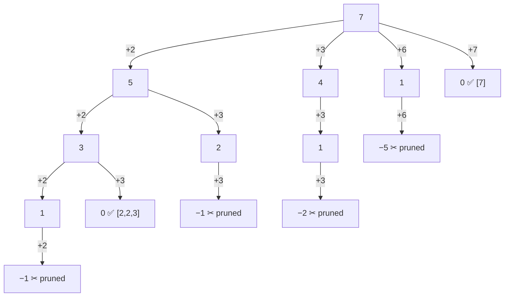

# 14 · Backtracking

<div class="pattern-card" markdown>
**One-liner:** Build candidates one choice at a time (**choose → explore → un-choose**) and abandon a branch the moment it can't lead to a solution.

**Typical cost:** <span class="cx time">O(2ⁿ · n) subsets · O(n! · n) permutations</span> <span class="cx space">O(n) recursion depth</span>

**⏱ Study time:** ~12 min
</div>

## Recognise it

!!! tip "Trigger phrases"
    - "return **all** subsets / combinations / permutations / partitions"
    - "generate every valid … (parentheses, IP addresses, sudoku fill)"
    - "place N queens", "word search on a board", "solve the puzzle"
    - Constraints are **small** (n ≤ ~20): a hint that exponential time is expected
    - The answer is a **list of lists**, not a single number (a single number usually means DP)

!!! info "Variants"
    **Subsets** (every node is an answer, `start = i + 1`) · **Combinations** (fixed size or target sum, `start = i` if reuse is allowed) · **Permutations** (only leaves, `used[]` array, scan from 0) · **Constraint search** (N-Queens, Sudoku: heavy pruning via `is_valid`).

## The picture

Backtracking walks a **decision tree**. Here is Combination Sum with `candidates = [2, 3, 6, 7]`, `target = 7`. Each edge is "pick this number", and each node shows the **remaining** target:



Because candidates are **sorted**, once one candidate overshoots, every candidate after it would too. One `break` cuts off the whole rest of that level.

The `path` list during the search (it grows and shrinks like a stack):

<div class="arr-label">choose 2, choose 2, choose 3 → hit 0, record a copy</div>
<div class="arr"><span>2</span><span>2</span><span class="hi">3</span></div>
<div class="arr-label">un-choose 3 (pop), un-choose 2 (pop), choose 3 …</div>
<div class="arr"><span>2</span><span class="hi">3</span><span class="dim">·</span></div>

## The template

```python
--8<-- "src/patterns/backtracking.py:template"
```

## Why this complexity?

| Problem | Leaves × copy cost | Total time | Space |
|---|---|---|---|
| Subsets of n | 2ⁿ subsets × O(n) copy | <span class="cx time">O(2ⁿ · n)</span> | <span class="cx space">O(n)</span> depth |
| Permutations of n | n! leaves × O(n) copy | <span class="cx time">O(n! · n)</span> | <span class="cx space">O(n)</span> depth |
| Combination Sum | branches^(target / min) | <span class="cx time">O(k^(T/m))</span> | <span class="cx space">O(T/m)</span> depth |
| N-Queens | ≤ n choices per row, n rows | <span class="cx time">O(n!)</span> | <span class="cx space">O(n)</span> |

**Rule of thumb:** *backtracking time ≈ (branching factor)^(depth) × work per node.* Two choices per element (in / out) gives **2ⁿ**. Shrinking choices (n, n−1, …) gives **n!**.

!!! warning "Pruning helps, but doesn't change the Big-O"
    `is_valid` / `break` skips whole subtrees, so real runtimes drop dramatically. The **worst case stays exponential**, because the output itself can be exponentially large (all 2ⁿ subsets *are* the answer). You can't produce 2ⁿ answers in less than 2ⁿ time.

    Output space (the results list) is **not** counted in the O(n) above. Only the recursion stack and `path` are.

## Worked problems

=== "78 · Subsets"

    **Problem:** return all subsets of distinct integers.

    **Insight:** **every node** in the tree is a valid subset, so record on entry with no base case. `start = i + 1` means you only look forward, which avoids duplicates like `[2,1]` vs `[1,2]`.

    ```python
    --8<-- "src/patterns/backtracking.py:subsets"
    ```

    <span class="cx time">O(2ⁿ · n)</span> <span class="cx space">O(n)</span>

=== "46 · Permutations"

    **Problem:** return all orderings of distinct integers.

    **Insight:** order matters, so scan from index 0 every time and skip `used` elements. Only **leaves** (full length) are answers.

    ```python
    --8<-- "src/patterns/backtracking.py:permutations"
    ```

    <span class="cx time">O(n! · n)</span> <span class="cx space">O(n)</span>

=== "39 · Combination Sum"

    **Problem:** all combinations (with reuse) of candidates that sum to `target`.

    **Insight:** recurse with `i` instead of `i + 1` so the same number can be reused. **Sort** first so you can `break` as soon as a candidate is too big.

    ```python
    --8<-- "src/patterns/backtracking.py:combination_sum"
    ```

    <span class="cx time">O(k^(T/m))</span> (k candidates, T target, m smallest) <span class="cx space">O(T/m)</span>

!!! example "Same skeleton, harder constraint: 51 · N-Queens"
    Choose a column for the queen in row `r` → explore row `r + 1` → un-choose. `is_valid` checks three sets: `cols`, `r − c` (↘ diagonals), `r + c` (↙ diagonals), each in O(1). It's the template with a smarter prune.

## Pitfalls

- **Appending `path` instead of `path[:]`:** every stored result becomes the same list, which ends up empty.
- **Forgetting to un-choose** (`pop()` / `used[i] = False`): later branches inherit stale state.
- **Duplicates in input** (Subsets II, Permutations II): sort, then skip `nums[i] == nums[i-1]` at the same tree level.
- **`i` vs `i + 1` vs `0`:** reuse allowed → `i`. No reuse, order irrelevant → `i + 1`. Order matters → `0` + `used`.

## Recall card

??? question "What are the three moves of backtracking?"
    **Choose** (`path.append(x)`), **explore** (`backtrack(...)`), **un-choose** (`path.pop()`). Record `path[:]` when it's a solution.

??? question "Subsets are O(?) and permutations are O(?), and why?"
    Subsets **O(2ⁿ · n)**: each element is in or out. Permutations **O(n! · n)**: n choices, then n−1, … The extra *n* is the cost of copying each answer.

## Practice

- [78. Subsets](https://leetcode.com/problems/subsets/)
- [46. Permutations](https://leetcode.com/problems/permutations/)
- [39. Combination Sum](https://leetcode.com/problems/combination-sum/)
- [51. N-Queens](https://leetcode.com/problems/n-queens/)
