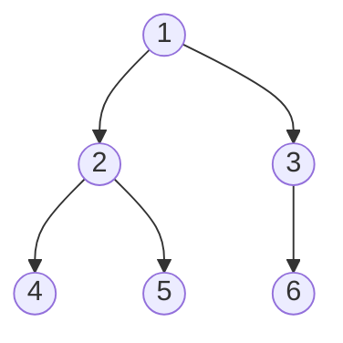
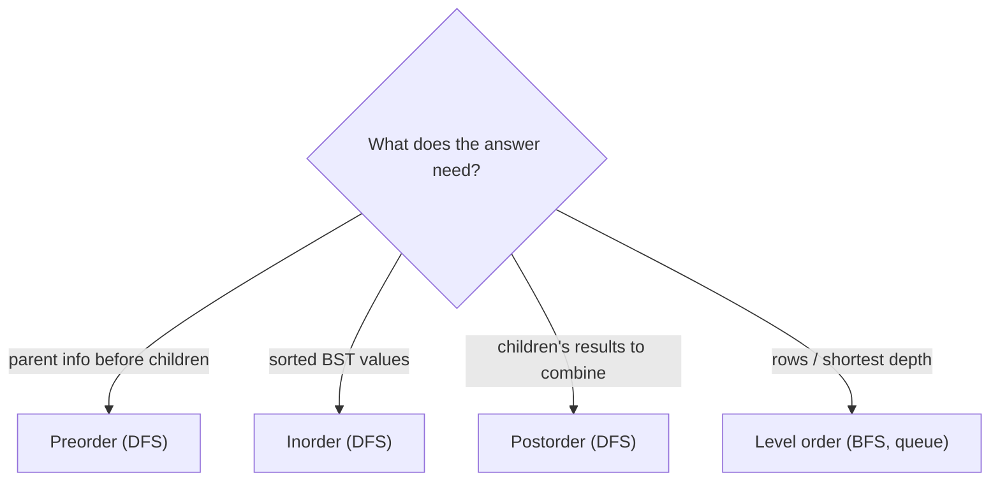

# 10 · Binary Tree Traversal

<div class="pattern-card" markdown>
**One-liner:** Visit every node exactly once. The **order** you choose (pre / in / post / level) decides what you can compute along the way.

**Typical cost:** <span class="cx time">O(n)</span> <span class="cx space">O(h)</span> (h = tree height)

**⏱ Study time:** ~10 min
</div>

## Recognise it

!!! tip "Trigger phrases"
    - Any problem whose input is a `TreeNode root`
    - "**level by level**", "zigzag", "right side view" → **level order** (BFS)
    - "BST … sorted", "k-th smallest", "validate BST" → **inorder**
    - "height", "diameter", "balanced?", "subtree sums" → **postorder** (children first, then combine)
    - "copy / serialize the tree", "path from root" → **preorder**

## The picture

One tree, four orders. The name says where the **node** goes relative to its children:



| Order | Rule | Visit sequence |
|---|---|---|
| **Pre**order | **node** → left → right | 1, 2, 4, 5, 3, 6 |
| **In**order | left → **node** → right | 4, 2, 5, 1, 3, 6 |
| **Post**order | left → right → **node** | 4, 5, 2, 6, 3, 1 |
| **Level** order | row by row (queue) | [1], [2, 3], [4, 5, 6] |

<div class="arr-label">inorder of a BST comes out sorted</div>
<div class="arr"><span>1</span><span>2</span><span class="hi">3</span><span>4</span><span>5</span><span>6</span></div>



The node type used throughout:

```python
--8<-- "src/patterns/structures.py:tree_node"
```

## The template

=== "Recursive pre / in / post"

    ```python
    --8<-- "src/patterns/binary_tree_traversal.py:recursive"
    ```

=== "Iterative inorder (stack)"

    ```python
    --8<-- "src/patterns/binary_tree_traversal.py:inorder_iterative"
    ```

=== "Level order (queue)"

    ```python
    --8<-- "src/patterns/binary_tree_traversal.py:level_order"
    ```

## Why this complexity?

| Step | Cost | Why |
|---|---|---|
| Visit all nodes | <span class="cx time">O(n)</span> | each node is pushed/visited once, constant work each |
| DFS stack (recursion or explicit) | <span class="cx space">O(h)</span> | holds one root-to-node path |
| — balanced tree | <span class="cx space">O(log n)</span> | height ≈ log₂ n |
| — skewed tree (a "linked list") | <span class="cx space">O(n)</span> | height = n |
| BFS queue | <span class="cx space">O(w)</span> | w = widest level, up to n/2 at the bottom of a full tree |
| Stop early (k-th smallest) | <span class="cx time">O(h + k)</span> | dive down once, then k visits |

**Rule of thumb:** *visiting every node once is O(n) time. The extra space is the depth of the stack (DFS = height) or the width of the queue (BFS).*

## Worked problems

=== "94 · Inorder (iterative)"

    **Problem:** return inorder traversal without recursion.

    **Insight:** simulate the call stack. Dive left pushing nodes, pop one and visit it, then turn right.

    ```python
    --8<-- "src/patterns/binary_tree_traversal.py:inorder_iterative"
    ```

    <span class="cx time">O(n)</span> <span class="cx space">O(h)</span>

=== "102 · Level Order"

    **Problem:** return node values grouped by depth.

    **Insight:** BFS with a queue. Freezing `len(queue)` at the start of each round gives exactly one level.

    ```python
    --8<-- "src/patterns/binary_tree_traversal.py:level_order"
    ```

    <span class="cx time">O(n)</span> <span class="cx space">O(w)</span>

=== "104 · Max Depth"

    **Problem:** height of the tree.

    **Insight:** postorder. Ask both children for their depth, then add 1. This is the shape of most "compute something about the tree" problems.

    ```python
    --8<-- "src/patterns/binary_tree_traversal.py:max_depth"
    ```

    <span class="cx time">O(n)</span> <span class="cx space">O(h)</span>

=== "230 · Kth Smallest in BST"

    **Problem:** k-th smallest value in a BST.

    **Insight:** inorder of a BST is **sorted**, so stop at the k-th visit. You never collect the full list.

    ```python
    --8<-- "src/patterns/binary_tree_traversal.py:kth_smallest"
    ```

    <span class="cx time">O(h + k)</span> <span class="cx space">O(h)</span>. Collecting all values and sorting is O(n log n).

## Pitfalls

- **Recursion depth:** Python's default limit is ~1000. A skewed tree with 10⁵ nodes overflows the stack, so use the iterative version.
- **List concatenation in recursion** (`left + [val] + right`) is neat, but each level copies lists, so it can degrade to O(n²) on skewed trees. In interviews, prefer appending to one shared list.
- **Level order without freezing the size:** `for _ in range(len(queue))` must read the length **before** the loop adds children.

## Recall card

??? question "Which traversal for: height, sorted BST order, row-by-row, cloning?"
    Height → **postorder**. Sorted BST → **inorder**. Row by row → **level order** (BFS queue). Cloning/serialising → **preorder**.

??? question "Time and space of a traversal, and why space varies?"
    Time is O(n): every node once. Space is O(h) for DFS, which is log n when balanced and n when skewed. For BFS it's O(w), the width of the widest level.

## Practice

- [94. Binary Tree Inorder Traversal](https://leetcode.com/problems/binary-tree-inorder-traversal/)
- [102. Binary Tree Level Order Traversal](https://leetcode.com/problems/binary-tree-level-order-traversal/)
- [104. Maximum Depth of Binary Tree](https://leetcode.com/problems/maximum-depth-of-binary-tree/)
- [230. Kth Smallest Element in a BST](https://leetcode.com/problems/kth-smallest-element-in-a-bst/)
