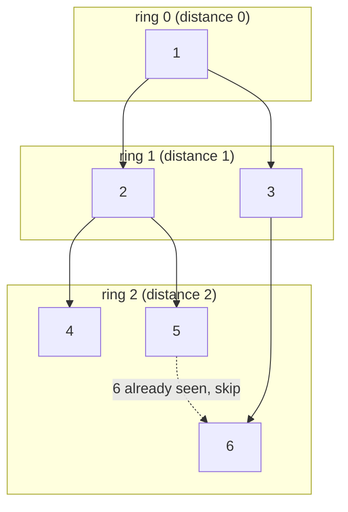

# 12 · Breadth-First Search

<div class="pattern-card" markdown>
**One-liner:** Expand outward in rings with a FIFO queue. The **first** time you reach a node, you reached it by the **shortest** path (in an unweighted graph).

**Typical cost:** <span class="cx time">O(V + E)</span> <span class="cx space">O(V)</span>

**⏱ Study time:** ~10 min
</div>

## Recognise it

!!! tip "Trigger phrases"
    - "**minimum** number of steps / moves / turns / transformations"
    - "**shortest** path" where every move costs the same (unweighted)
    - "how many minutes until everything is infected / rotten / filled" (**multi-source** BFS)
    - "nearest X from every cell"
    - States are implicit: lock combinations, words, board positions. **Generate neighbours on the fly.**

!!! info "Variants"
    **Single-source** (one start) · **Multi-source** (seed the queue with all starts at distance 0) · **Level-by-level** (`for _ in range(len(queue))` when you need the ring number) · Tree level-order traversal is the same idea on a tree, see [pattern 10](binary-tree-traversal.md).

## The picture

Same graph as the DFS page, but BFS visits it **ring by ring**: everything 1 step away, then everything 2 steps away.



The queue over time. The front is on the left; **highlighted** = being popped, **green** = just enqueued:

<div class="arr-label">step 1: pop 1, enqueue its neighbours</div>
<div class="arr"><span class="hi">1</span><span class="win">2</span><span class="win">3</span></div>
<div class="arr-label">step 2: pop 2, enqueue 4, 5</div>
<div class="arr"><span class="dim">1</span><span class="hi">2</span><span>3</span><span class="win">4</span><span class="win">5</span></div>
<div class="arr-label">step 3: pop 3, enqueue 6</div>
<div class="arr"><span class="dim">1</span><span class="dim">2</span><span class="hi">3</span><span>4</span><span>5</span><span class="win">6</span></div>

Because the queue is FIFO, every ring-*d* node is popped before any ring-*(d+1)* node, so distances come out correct automatically.

## The template

=== "Distances"

    ```python
    --8<-- "src/patterns/breadth_first_search.py:template"
    ```

=== "Level by level"

    ```python
    --8<-- "src/patterns/breadth_first_search.py:template_levels"
    ```

## Why this complexity?

| Step | Cost | Why |
|---|---|---|
| Enqueue/dequeue each node | <span class="cx time">O(V)</span> | a node enters the queue only when first seen |
| Scan neighbours | <span class="cx time">O(E)</span> | each edge is examined once from its popped endpoint |
| Total | <span class="cx time">O(V + E)</span> | identical to DFS. The order differs, not the work |
| Queue + seen set | <span class="cx space">O(V)</span> | widest ring can hold almost all nodes |
| Implicit state graph | <span class="cx time">O(states × moves)</span> | e.g. lock: 10⁴ states × 8 moves |

**Rule of thumb:** *BFS = DFS cost, O(V + E), plus a free guarantee: first visit = shortest path.* Need shortest + weights? That's Dijkstra (heap, O(E log V)), beyond these 15.

## Worked problems

=== "752 · Open the Lock"

    **Problem:** 4-wheel lock starts at `"0000"`. Each turn moves one wheel ±1. Avoid dead-ends and return the minimum turns to reach `target`.

    **Insight:** the graph is **implicit**: each state has 8 neighbours. Minimum turns means shortest path means BFS.

    ```python
    --8<-- "src/patterns/breadth_first_search.py:open_the_lock"
    ```

    <span class="cx time">O(10⁴ · 8)</span> = O(1) bounded <span class="cx space">O(10⁴)</span>. DFS would find *a* path, not the shortest.

=== "994 · Rotting Oranges"

    **Problem:** each minute, rotten oranges rot their 4 neighbours. How many minutes until none are fresh?

    **Insight:** **multi-source BFS**. Put *all* rotten oranges in the queue at minute 0. Each level of the BFS is one minute.

    ```python
    --8<-- "src/patterns/breadth_first_search.py:rotting_oranges"
    ```

    <span class="cx time">O(R·C)</span> <span class="cx space">O(R·C)</span>. Running one BFS per rotten orange would cost O((R·C)²).

=== "1091 · Shortest Path in Binary Matrix"

    **Problem:** shortest clear path (0-cells, 8-directional) from top-left to bottom-right.

    **Insight:** grid cells are nodes and the 8 neighbours are edges. Mark cells visited **when enqueued** so no cell is added twice.

    ```python
    --8<-- "src/patterns/breadth_first_search.py:shortest_path_binary_matrix"
    ```

    <span class="cx time">O(n²)</span> <span class="cx space">O(n²)</span>

## Pitfalls

- **Mark when enqueued, not when popped.** Otherwise the same node is added many times and both time and memory blow up.
- **`list.pop(0)` is O(n).** Always use `collections.deque` with `popleft()`.
- **Level counting:** snapshot `len(queue)` *before* the inner loop. The queue grows while you iterate.
- **Multi-source:** seed **all** sources before the loop. Seeding them one by one gives wrong distances.

## Recall card

??? question "Why does BFS give shortest paths but DFS doesn't?"
    The FIFO queue processes nodes in order of distance: every distance-*d* node before any distance-*(d+1)* node. So the first arrival is the shortest. DFS may reach a node via a long detour first.

??? question "How do you get 'minutes' or 'levels' out of BFS?"
    `while queue: for _ in range(len(queue)): …process one ring…; level += 1`.

## Practice

- [752. Open the Lock](https://leetcode.com/problems/open-the-lock/)
- [994. Rotting Oranges](https://leetcode.com/problems/rotting-oranges/)
- [1091. Shortest Path in Binary Matrix](https://leetcode.com/problems/shortest-path-in-binary-matrix/)
- [127. Word Ladder](https://leetcode.com/problems/word-ladder/)
