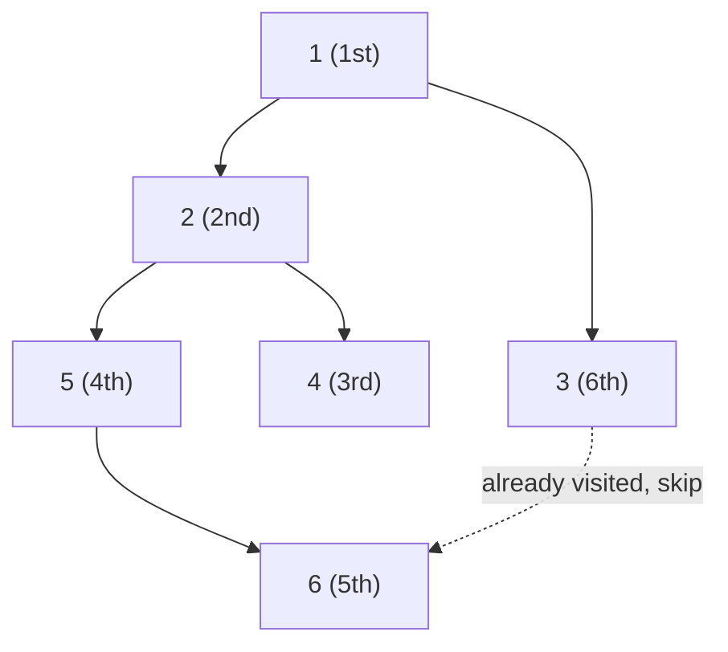

# 11 · Depth-First Search

<div class="pattern-card" markdown>
**One-liner:** Follow one path as deep as it goes, then back up and try the next. Use a `visited` set so every node is touched once.

**Typical cost:** <span class="cx time">O(V + E)</span> <span class="cx space">O(V)</span>

**⏱ Study time:** ~10 min
</div>

## Recognise it

!!! tip "Trigger phrases"
    - "connected components", "number of provinces / groups / islands"
    - "is there a **path** from A to B?" (any path, **not** the shortest)
    - "detect a **cycle**", "can all courses be finished?", "topological order"
    - "clone / copy a graph", "explore everything reachable"
    - Input is an **adjacency list**, an edge list, or an adjacency matrix

!!! info "Variants"
    **Recursive** (shortest code, uses the call stack) · **Iterative** (explicit stack, no recursion limit) · **3-colour DFS** (white/grey/black) for cycle detection in *directed* graphs.

## The picture

DFS plunges down one branch before touching its siblings. The numbers in brackets are the **visit order**:



Order: **1 → 2 → 4 → (back) → 5 → 6 → (back, back, back) → 3**. When 3 looks at 6, the `visited` set says "done", so no node is ever processed twice.

<div class="arr-label">call stack while visiting 6 (deepest point)</div>
<div class="arr"><span>1</span><span>2</span><span>5</span><span class="hi">6</span></div>
<div class="arr-label">visited set at the end</div>
<div class="arr"><span class="win">1</span><span class="win">2</span><span class="win">4</span><span class="win">5</span><span class="win">6</span><span class="win">3</span></div>

!!! note "DFS vs BFS in one sentence"
    DFS uses a **stack** (go deep), BFS uses a **queue** (go wide). Same `visited` trick, same O(V + E). Only BFS gives **shortest** paths in unweighted graphs ([pattern 12](breadth-first-search.md)).

## The template

=== "Recursive"

    ```python
    --8<-- "src/patterns/depth_first_search.py:template_recursive"
    ```

=== "Iterative (explicit stack)"

    ```python
    --8<-- "src/patterns/depth_first_search.py:template_iterative"
    ```

## Why this complexity?

| Step | Cost | Why |
|---|---|---|
| Visit every node | <span class="cx time">O(V)</span> | `visited` guarantees each node enters `dfs` once |
| Scan every edge | <span class="cx time">O(E)</span> | each adjacency list is read once, when its node is visited |
| Total | <span class="cx time">O(V + E)</span> | nodes + edges, each touched a constant number of times |
| `visited` + stack | <span class="cx space">O(V)</span> | worst case: a long chain makes the stack V deep |
| Adjacency **matrix** input | <span class="cx time">O(V²)</span> | finding neighbours means scanning a whole row |

**Rule of thumb:** *graph traversal = touch every node once + every edge once → O(V + E).* The `visited` set turns a potentially exponential walk into a linear one.

## Worked problems

=== "133 · Clone Graph"

    **Problem:** deep-copy an undirected, possibly cyclic graph.

    **Insight:** the `original → copy` dict *is* the visited set. Register the copy **before** recursing into neighbours, otherwise a cycle recurses forever.

    ```python
    --8<-- "src/patterns/depth_first_search.py:clone_graph"
    ```

    <span class="cx time">O(V + E)</span> <span class="cx space">O(V)</span>

=== "547 · Number of Provinces"

    **Problem:** given an `n × n` adjacency matrix of cities, count the connected groups.

    **Insight:** loop over all nodes; each time you hit an **unvisited** one, start a DFS. That DFS swallows its whole component, so the number of DFS starts equals the number of components.

    ```python
    --8<-- "src/patterns/depth_first_search.py:number_of_provinces"
    ```

    <span class="cx time">O(n²)</span> (matrix input) <span class="cx space">O(n)</span>

=== "207 · Course Schedule"

    **Problem:** can you take all courses given `[course, prerequisite]` pairs? This is a cycle check in a directed graph.

    **Insight:** **3-colour DFS.** *Grey* = on the current recursion path. Reaching a grey node means you looped back onto your own path, i.e. a cycle. *Black* = fully explored and safe, so never re-explore it.

    ```python
    --8<-- "src/patterns/depth_first_search.py:course_schedule"
    ```

    <span class="cx time">O(V + E)</span> <span class="cx space">O(V + E)</span>. Without the black state, nodes get re-explored and the worst case blows up exponentially.

## Pitfalls

- **Marking too late:** mark `visited` when you *enter* a node (or push it), not after its children finish, or cycles loop forever.
- **Python recursion limit:** about 1000 frames by default. For deep graphs (10⁴+ nodes in a chain) use the iterative version or `sys.setrecursionlimit`.
- **Directed cycle ≠ "seen before":** in a directed graph, revisiting a *black* node is fine. Only a *grey* node is a cycle. A plain `visited` set gives false positives.
- **Disconnected graphs:** a single `dfs(start)` misses other components. Loop over all nodes.

## Recall card

??? question "What are the three lines every DFS has?"
    `if node in visited: return` → `visited.add(node)` → `for nxt in graph[node]: dfs(nxt)`.
    Cost: **O(V + E)** time, **O(V)** space.

??? question "How do you count connected components?"
    `for each node: if not visited → dfs(node); count += 1`. Each DFS start is one component.

## Practice

- [133. Clone Graph](https://leetcode.com/problems/clone-graph/)
- [547. Number of Provinces](https://leetcode.com/problems/number-of-provinces/)
- [207. Course Schedule](https://leetcode.com/problems/course-schedule/)
- [797. All Paths From Source to Target](https://leetcode.com/problems/all-paths-from-source-to-target/)
