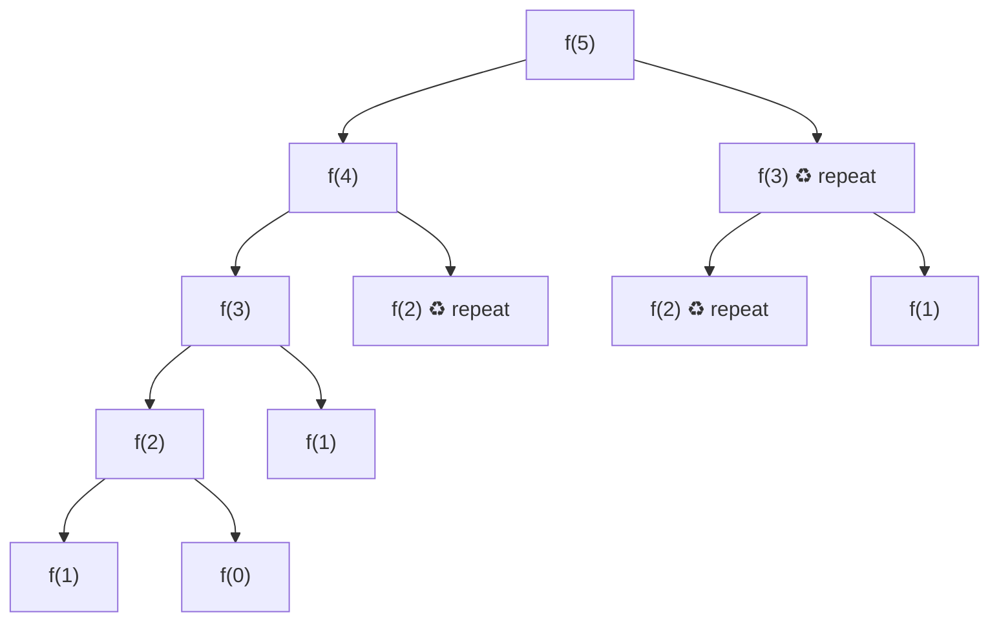
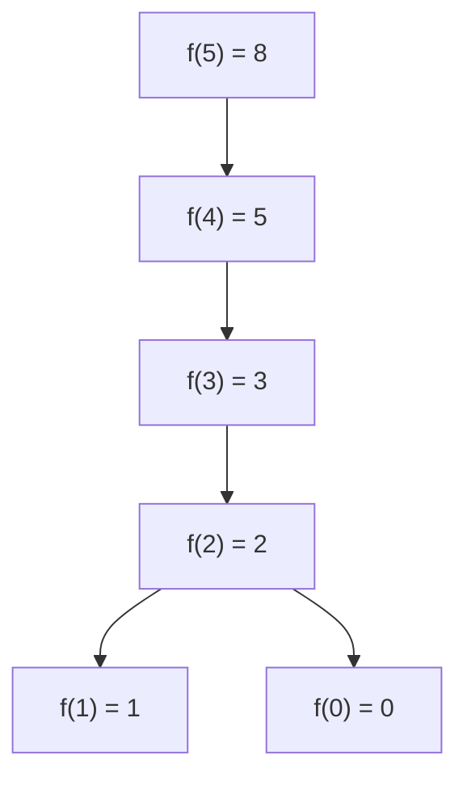
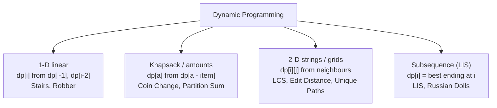

# 15 · Dynamic Programming

<div class="pattern-card" markdown>
**One-liner:** When a recursion solves the **same subproblem many times**, store each answer once (memo or table). Exponential becomes polynomial.

**Typical cost:** <span class="cx time">O(#states × work per state)</span> <span class="cx space">O(#states), often reducible</span>

**⏱ Study time:** ~15 min
</div>

## Recognise it

!!! tip "Trigger phrases"
    - "**number of ways** to …", "**minimum / maximum** cost / profit / length"
    - "can you reach / make / partition …?" (true/false over choices)
    - "longest increasing / common subsequence", "edit distance"
    - Choices at each step, and **future options depend only on a small summary of the past** (index, remaining amount, …)
    - You need a single **number**, not a list of all solutions. Listing them all is [backtracking](backtracking.md).

## The picture

Plain recursion for Climbing Stairs / Fibonacci recomputes the same calls over and over:



The tree doubles at every level, so it costs **O(2ⁿ)**. But there are only **n + 1 distinct** calls. With a memo, every `♻` node is an O(1) lookup and the tree collapses into a chain:



Bottom-up, you fill the same values left to right in a table:

<div class="arr-label">dp[i] = dp[i−1] + dp[i−2]  (computing dp[5])</div>
<div class="arr"><span class="dim">0</span><span class="dim">1</span><span class="dim">1</span><span class="win">2</span><span class="win">3</span><span class="hi">5</span><span>·</span></div>
<div class="arr ptr"><span>0</span><span>1</span><span>2</span><span>3</span><span>4</span><span>5</span><span>6</span></div>

Only the two green cells are ever read. That's why the space can shrink to **O(1)** with two variables.

## The 4-step recipe

1. **State:** what does `dp[i]` (or `dp[i][j]`) *mean*? Write it as a sentence.
2. **Recurrence:** how does a state follow from smaller states? (Consider the **last** choice.)
3. **Base case:** the smallest states you know directly (`dp[0]`, empty string, …).
4. **Order:** compute dependencies first (left→right, top→bottom), or let memoised recursion handle the order.

## The template

=== "Top-down (memo)"

    ```python
    --8<-- "src/patterns/dynamic_programming.py:template_top_down"
    ```

=== "Bottom-up (table)"

    ```python
    --8<-- "src/patterns/dynamic_programming.py:template_bottom_up"
    ```

## Why this complexity?

!!! success "The one formula to remember"
    **Time = (number of distinct states) × (work to compute one state)**

    **Space = number of states you store** (often only the last row / last 2 values matter)

| Problem | States | Work / state | Time | Space |
|---|---|---|---|---|
| Climbing Stairs / Fib | n | O(1) | <span class="cx time">O(n)</span> | <span class="cx space">O(1)</span> rolling |
| House Robber | n | O(1) | <span class="cx time">O(n)</span> | <span class="cx space">O(1)</span> rolling |
| Coin Change | amount A | k coins | <span class="cx time">O(A · k)</span> | <span class="cx space">O(A)</span> |
| LCS (two strings) | m × n | O(1) | <span class="cx time">O(m · n)</span> | <span class="cx space">O(m · n)</span>, O(n) with one row |
| LIS (classic) | n | n (scan earlier) | <span class="cx time">O(n²)</span> | <span class="cx space">O(n)</span> |

**Rule of thumb:** *naive recursion is exponential because of repeats. Memoising caps the work at #states × work-per-state.* Space shrinks whenever `dp[i]` only depends on the last few rows or values.

## DP sub-patterns at a glance



## Worked problems

=== "70 · Climbing Stairs"

    **Problem:** climb `n` steps taking 1 or 2 at a time. How many distinct ways?

    **Insight:** the last move was either a 1-step or a 2-step, so `ways(n) = ways(n−1) + ways(n−2)`. That's Fibonacci. Keep only the two previous values.

    ```python
    --8<-- "src/patterns/dynamic_programming.py:climbing_stairs"
    ```

    <span class="cx time">O(n)</span> <span class="cx space">O(1)</span>, versus O(2ⁿ) naive recursion.

=== "198 · House Robber"

    **Problem:** max money from houses in a row, never robbing two adjacent ones.

    **Insight:** at each house you either **skip** it (best so far) or **take** it (best that skipped the previous house + this money). `dp[i] = max(dp[i−1], dp[i−2] + nums[i])`.

    ```python
    --8<-- "src/patterns/dynamic_programming.py:house_robber"
    ```

    <span class="cx time">O(n)</span> <span class="cx space">O(1)</span>, versus O(2ⁿ) trying every non-adjacent subset.

=== "322 · Coin Change"

    **Problem:** fewest coins to make `amount` (unlimited coins of each type), or −1.

    **Insight:** **unbounded knapsack.** State = amount. The last coin is one of `k` choices, so `dp[a] = 1 + min(dp[a − coin])`. Greedy (biggest coin first) **fails**: for coins `[1, 3, 4]` and amount 6, greedy gives 4+1+1 but the best is 3+3.

    ```python
    --8<-- "src/patterns/dynamic_programming.py:coin_change"
    ```

    <span class="cx time">O(amount · k)</span> <span class="cx space">O(amount)</span>

=== "1143 · Longest Common Subsequence"

    **Problem:** length of the longest subsequence common to two strings.

    **Insight:** **2-D DP.** `dp[i][j]` = LCS of the first `i` chars and the first `j` chars. If the last chars match, extend the diagonal. Otherwise drop one char from either string and take the max.

    ```python
    --8<-- "src/patterns/dynamic_programming.py:lcs"
    ```

    <span class="cx time">O(m · n)</span> <span class="cx space">O(m · n)</span>, versus O(2^(m+n)) enumerating subsequences.

## Pitfalls

- **Vague state definition:** if you can't say what `dp[i]` means in one sentence, the recurrence will be wrong.
- **Wrong iteration order:** bottom-up must compute `dp[i−1]` before `dp[i]`. 2-D tables usually go row by row.
- **Off-by-one table size:** use `n + 1` / `(m+1) × (n+1)` so index 0 can mean "empty prefix".
- **Python recursion depth** with `@cache` on large n (> ~1000): switch to bottom-up.
- **Greedy temptation:** if a local "best choice" can be beaten later (Coin Change), you need DP.

## Recall card

??? question "What is the complexity formula for any DP?"
    **#states × work per state.** Space = #states stored, often reducible to the last row or the last few values.

??? question "DP or backtracking?"
    Need **all** solutions listed → backtracking (exponential output). Need a **count / min / max / yes-no** and subproblems repeat → DP (polynomial).

## Practice

- [70. Climbing Stairs](https://leetcode.com/problems/climbing-stairs/)
- [198. House Robber](https://leetcode.com/problems/house-robber/)
- [322. Coin Change](https://leetcode.com/problems/coin-change/)
- [1143. Longest Common Subsequence](https://leetcode.com/problems/longest-common-subsequence/)
- [300. Longest Increasing Subsequence](https://leetcode.com/problems/longest-increasing-subsequence/)
