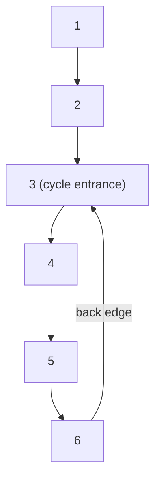

# 4 · Fast & Slow Pointers

<div class="pattern-card" markdown>
**One-liner:** Run two pointers at different speeds (1 step and 2 steps). If there's a loop, the fast one **laps** the slow one; if not, it falls off the end. As a bonus, slow stops at the **middle**.

**Typical cost:** <span class="cx time">O(n)</span> <span class="cx space">O(1)</span>

**⏱ Study time:** ~8 min
</div>

## Recognise it

!!! tip "Trigger phrases"
    - "detect a **cycle**" / "does it **loop forever**?"
    - "find the **start** of the cycle"
    - "find the **middle** of a linked list" / "split the list in half"
    - "repeated process on a number" (happy number): an implicit sequence that may cycle
    - "array of n + 1 values in range [1, n], **O(1) extra space**, don't modify the array"
    - Linked-list problem with an **O(1) space** constraint (no hash set allowed)

## The picture

The list `1 → 2 → 3 → 4 → 5 → 6`, where `6` links back to `3`. Speed difference is 1, so inside the loop the gap closes by one each step:



| step | slow (1×) | fast (2×) |
|---|---|---|
| 0 | 1 | 1 |
| 1 | 2 | 3 |
| 2 | 3 | 5 |
| 3 | 4 | 3 |
| 4 | **5** | **5** ✅ meet |

**Middle of a list:** when fast reaches the end it has walked 2·k nodes, slow has walked k, so slow sits at the middle:

<div class="arr"><span>1</span><span>2</span><span class="hi">3</span><span>4</span><span class="win">5</span></div>
<div class="arr ptr"><span></span><span></span><span>slow</span><span></span><span>fast</span></div>

!!! note "Phase 2: where does the cycle start?"
    After the pointers meet, reset one pointer to the head and move **both at speed 1**. They meet again exactly at the cycle entrance. (Math: distance head→entrance ≡ distance meeting point→entrance, modulo the cycle length.) That's how LeetCode 142 and 287 are solved.

## The template

```python
--8<-- "src/patterns/fast_slow_pointers.py:template"
```

The node type used throughout:

```python
--8<-- "src/patterns/structures.py:list_node"
```

## Why this complexity?

| Step | Cost | Why |
|---|---|---|
| No cycle | <span class="cx time">O(n)</span> | fast reaches the end after n/2 iterations |
| With cycle | <span class="cx time">O(n)</span> | slow enters the loop within n steps; inside, the gap shrinks by 1 per step, so they meet in ≤ loop-length more steps |
| Memory | <span class="cx space">O(1)</span> | two references, **no visited set** |

**Rule of thumb:** *a speed difference of 1 means the chase ends within one lap, so time is linear.* The pattern's whole point is **O(1) space**: a `set()` of visited nodes also detects cycles in O(n) time but costs O(n) memory.

## Worked problems

=== "141 · Linked List Cycle"

    **Problem:** does the linked list contain a cycle?

    **Insight:** template verbatim. Compare nodes with `is` (identity), not values.

    ```python
    --8<-- "src/patterns/fast_slow_pointers.py:linked_list_cycle"
    ```

    <span class="cx time">O(n)</span> <span class="cx space">O(1)</span>, vs. O(n) space with a visited set.

=== "876 · Middle of the Linked List"

    **Problem:** return the middle node (second middle for even length).

    **Insight:** stop when fast can't take two steps. Slow is at the middle.

    ```python
    --8<-- "src/patterns/fast_slow_pointers.py:middle_node"
    ```

    <span class="cx time">O(n)</span> <span class="cx space">O(1)</span>, one pass instead of "count length, then walk n/2".

=== "287 · Find the Duplicate Number"

    **Problem:** `n + 1` integers in `[1, n]`, exactly one value repeated. O(1) space, don't modify `nums`.

    **Insight:** read `i → nums[i]` as a **next pointer**. Two indices point to the duplicate value, so it's the cycle's entrance. Run both phases of Floyd's algorithm.

    ```python
    --8<-- "src/patterns/fast_slow_pointers.py:find_duplicate"
    ```

    <span class="cx time">O(n)</span> <span class="cx space">O(1)</span>, vs. O(n) space with a set or O(n log n) after sorting (which modifies the array).

=== "202 · Happy Number"

    **Problem:** repeatedly replace `n` by the sum of the squares of its digits. Does it reach 1?

    **Insight:** the sequence either hits 1 or loops forever, so it's an implicit linked list. Detect the loop without storing seen numbers.

    ```python
    --8<-- "src/patterns/fast_slow_pointers.py:happy_number"
    ```

    <span class="cx time">O(log n)</span> per step <span class="cx space">O(1)</span>

## Pitfalls

- **Loop guard:** check `fast and fast.next` before `fast.next.next`, or you'll crash on even-length lists.
- **Compare identity, not value:** `slow is fast`. Different nodes may hold equal values.
- **Even-length middle:** this template returns the **second** middle. For the first middle (e.g. to split a list for merge sort), start `fast = head.next`.
- **287 phase 2:** reset `slow` to `nums[0]` (the head), not to index `0`'s position in the cycle.

## Recall card

??? question "Why must fast and slow meet if there's a cycle?"
    Once both are in the loop, fast gains exactly 1 node per step on slow. The gap shrinks n, n−1, …, 0, so it can't jump over slow. They meet within one loop length.

??? question "How do you find the cycle's start after they meet?"
    Move one pointer back to the head, then advance **both one step at a time**. Where they meet is the entrance.

## Practice

- [141. Linked List Cycle](https://leetcode.com/problems/linked-list-cycle/)
- [142. Linked List Cycle II](https://leetcode.com/problems/linked-list-cycle-ii/)
- [876. Middle of the Linked List](https://leetcode.com/problems/middle-of-the-linked-list/)
- [287. Find the Duplicate Number](https://leetcode.com/problems/find-the-duplicate-number/)
