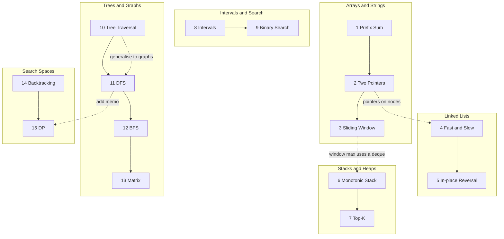

# Patterns

The 15 patterns are grouped by the data structure they usually work on. Work through them in order; later groups reuse ideas from earlier ones (BFS reuses the queue from level-order traversal, DP is backtracking plus memo).

| Group | Patterns | Shared idea |
|---|---|---|
| Arrays & Strings | [Prefix Sum](prefix-sum.md) · [Two Pointers](two-pointers.md) · [Sliding Window](sliding-window.md) | replace the O(n²) pair scan with one O(n) pass |
| Linked Lists | [Fast & Slow](fast-slow-pointers.md) · [In-place Reversal](linked-list-reversal.md) | O(1) extra space by rewiring / racing pointers |
| Stacks & Heaps | [Monotonic Stack](monotonic-stack.md) · [Top-K](top-k-elements.md) | the right container keeps only what still matters |
| Intervals & Search | [Overlapping Intervals](overlapping-intervals.md) · [Binary Search](modified-binary-search.md) | sorted order unlocks the answer |
| Trees & Graphs | [Tree Traversal](binary-tree-traversal.md) · [DFS](depth-first-search.md) · [BFS](breadth-first-search.md) · [Matrix](matrix-traversal.md) | visit each node once → O(V + E) |
| Search Spaces | [Backtracking](backtracking.md) · [DP](dynamic-programming.md) | enumerate choices; cache repeated sub-answers |
