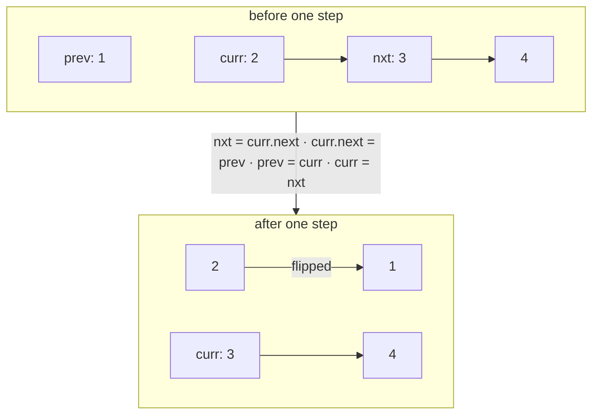

# 5 · Linked List In-place Reversal

<div class="pattern-card" markdown>
**One-liner:** Walk the list with three references, `prev`, `curr` and `nxt`, and **flip one arrow per step**. No copying, no extra list.

**Typical cost:** <span class="cx time">O(n)</span> <span class="cx space">O(1)</span>

**⏱ Study time:** ~8 min
</div>

## Recognise it

!!! tip "Trigger phrases"
    - "**reverse** the linked list" (whole, or between positions *m* and *n*)
    - "reverse nodes in **k-groups**", "**swap** nodes in pairs"
    - "**in place**" / "O(1) extra memory" on a linked list
    - "is the linked list a **palindrome**?" (find the middle with [fast & slow](fast-slow-pointers.md), then reverse the second half)
    - "reorder list" (`L0 → Ln → L1 → Ln−1 …`)

## The picture

The four-line dance. Before the step, `curr` still points forward; after it, `curr` points back to `prev`:



The whole run on `1 → 2 → 3 → 4`. Yellow is `curr`, green is the already-reversed part:

<div class="arr-label">start: prev = None</div>
<div class="arr"><span class="hi">1</span><span>2</span><span>3</span><span>4</span></div>
<div class="arr-label">after step 1: None ← 1</div>
<div class="arr"><span class="win">1</span><span class="hi">2</span><span>3</span><span>4</span></div>
<div class="arr-label">after step 2: None ← 1 ← 2</div>
<div class="arr"><span class="win">1</span><span class="win">2</span><span class="hi">3</span><span>4</span></div>
<div class="arr-label">done: None ← 1 ← 2 ← 3 ← 4, return prev (= 4)</div>
<div class="arr"><span class="win">1</span><span class="win">2</span><span class="win">3</span><span class="win">4</span></div>

!!! note "The dummy-node trick"
    When the head itself might change (reversing from position 1, swapping the first pair), put a `dummy = ListNode(0, head)` in front. Then every real node has a predecessor, and you return `dummy.next`. No special case for the head.

## The template

```python
--8<-- "src/patterns/linked_list_reversal.py:template"
```

## Why this complexity?

| Step | Cost | Why |
|---|---|---|
| Walk the list | <span class="cx time">O(n)</span> | each node is visited once |
| Flip one arrow | <span class="cx time">O(1)</span> | four reference assignments |
| Memory | <span class="cx space">O(1)</span> | three pointers, re-wiring the existing nodes |
| Recursive version | <span class="cx space">O(n)</span> | call stack depth n, so prefer iteration |

**Rule of thumb:** *one pass, constant work per node, so O(n) time; you re-wire, never allocate, so O(1) space.* Copying values into an array and rebuilding would also be O(n) time but O(n) space.

## Worked problems

=== "206 · Reverse Linked List"

    **Problem:** reverse the whole list.

    **Insight:** the template. Python's tuple assignment does all four steps in one line (right side evaluated first).

    ```python
    --8<-- "src/patterns/linked_list_reversal.py:reverse_list"
    ```

    <span class="cx time">O(n)</span> <span class="cx space">O(1)</span>

=== "92 · Reverse Linked List II"

    **Problem:** reverse only positions `left..right` (1-indexed), in one pass.

    **Insight:** walk a `before` pointer to position `left − 1` (dummy node handles `left = 1`). Reverse `right − left + 1` nodes with the template, then **stitch** both ends back on.

    ```python
    --8<-- "src/patterns/linked_list_reversal.py:reverse_between"
    ```

    <span class="cx time">O(n)</span> <span class="cx space">O(1)</span>

=== "24 · Swap Nodes in Pairs"

    **Problem:** swap every two adjacent nodes (re-wire nodes, don't swap values).

    **Insight:** reversal with group size 2. For each pair `a, b` behind `prev`: `a → b.next`, `b → a`, `prev → b`, then move `prev` to `a`.

    ```python
    --8<-- "src/patterns/linked_list_reversal.py:swap_pairs"
    ```

    <span class="cx time">O(n)</span> <span class="cx space">O(1)</span>. The generalisation is [25. Reverse Nodes in k-Group](https://leetcode.com/problems/reverse-nodes-in-k-group/).

## Pitfalls

- **Losing the rest of the list:** save `nxt = curr.next` **before** overwriting `curr.next`.
- **Returning `head`** instead of `prev`: after reversal the old head is the tail.
- **Sublist reversal:** remember to reconnect **both** ends (`before.next` and the old first node's `next`).
- **Tuple-assignment order:** `curr.next, prev, curr = prev, curr, curr.next` works, but reordering the targets can break it. When unsure, write the four lines.

## Recall card

??? question "Recite the four lines of the reversal loop."
    `nxt = curr.next` → `curr.next = prev` → `prev = curr` → `curr = nxt`. Save, flip, advance, advance. Return `prev`.

??? question "When do you need a dummy node?"
    Whenever the original head might not be the final head (reversal starting at position 1, pair swaps, deletions at the front). The dummy gives the head a predecessor so one code path handles everything.

## Practice

- [206. Reverse Linked List](https://leetcode.com/problems/reverse-linked-list/)
- [92. Reverse Linked List II](https://leetcode.com/problems/reverse-linked-list-ii/)
- [24. Swap Nodes in Pairs](https://leetcode.com/problems/swap-nodes-in-pairs/)
- [234. Palindrome Linked List](https://leetcode.com/problems/palindrome-linked-list/)
