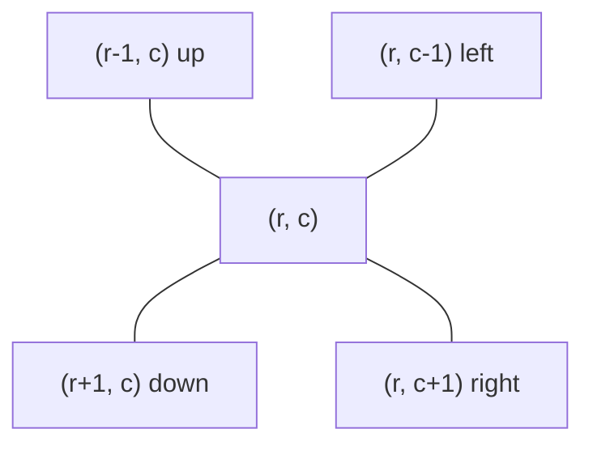

# 13 · Matrix Traversal

<div class="pattern-card" markdown>
**One-liner:** A grid is a graph in disguise: each cell is a node and its 4 (or 8) neighbours are its edges. Run DFS/BFS over it with a direction vector.

**Typical cost:** <span class="cx time">O(R · C)</span> <span class="cx space">O(R · C)</span>

**⏱ Study time:** ~10 min
</div>

## Recognise it

!!! tip "Trigger phrases"
    - Input is a **2-D grid / board / image / map**
    - "number of **islands**", "connected regions", "flood fill", "paint bucket"
    - "spread to adjacent cells" (often with BFS, see [Rotting Oranges](breadth-first-search.md))
    - "traverse in **spiral** / diagonal / layer order", "**rotate** the matrix in place"

!!! info "Variants"
    **Graph-style** (DFS/BFS flood over connected cells) · **Index-geometry** (spiral, rotate, diagonals: pure index bookkeeping, no visited set).

## The picture

The **direction vector** is the whole trick. From any cell `(r, c)`, the neighbours are `(r + dr, c + dc)`:



Counting islands: scan row by row. At each unvisited `1`, count +1 and **sink** the whole island so you never count it again.

<div class="arr-label">row 0</div>
<div class="arr"><span class="hi">1</span><span class="hi">1</span><span>0</span><span>0</span><span>0</span></div>
<div class="arr-label">row 1</div>
<div class="arr"><span class="hi">1</span><span class="hi">1</span><span>0</span><span>0</span><span>0</span></div>
<div class="arr-label">row 2</div>
<div class="arr"><span>0</span><span>0</span><span class="win">1</span><span>0</span><span>0</span></div>
<div class="arr-label">row 3</div>
<div class="arr"><span>0</span><span>0</span><span>0</span><span class="dim">1</span><span class="dim">1</span></div>

Yellow, green and grey are three islands, so the answer is **3**.

## The template

```python
--8<-- "src/patterns/matrix_traversal.py:template"
```

Every grid DFS follows the same four steps: **bounds check → cell check → mark → recurse in 4 directions**.

## Why this complexity?

| Step | Cost | Why |
|---|---|---|
| Outer scan | <span class="cx time">O(R·C)</span> | every cell is looked at once |
| All flood fills together | <span class="cx time">O(R·C)</span> | a cell is marked once, then rejected instantly forever |
| Total | <span class="cx time">O(R·C)</span> | graph with V = R·C, E ≤ 4·R·C, so O(V + E) = O(R·C) |
| Recursion / queue | <span class="cx space">O(R·C)</span> | worst case: a snake-shaped island fills the stack |
| Spiral / rotate | <span class="cx time">O(R·C)</span> <span class="cx space">O(1)</span> | each cell moved once, only boundary indices stored |

**Rule of thumb:** *grid = graph with V = R·C, so traversal is O(R·C).* The nested "for each cell → flood" looks quadratic, but marking means total work stays linear in the number of cells.

## Worked problems

=== "200 · Number of Islands"

    **Problem:** count groups of 4-connected `"1"`s.

    **Insight:** connected components on a grid. Each unvisited land cell starts a new island, and the DFS sinks it in place (no extra `visited` set needed).

    ```python
    --8<-- "src/patterns/matrix_traversal.py:number_of_islands"
    ```

    <span class="cx time">O(R·C)</span> <span class="cx space">O(R·C)</span> recursion worst case

=== "733 · Flood Fill"

    **Problem:** paint-bucket: recolour the region connected to `(sr, sc)`.

    **Insight:** the template, almost verbatim. Guard `original == color`, otherwise painting never changes the cell and the recursion loops forever.

    ```python
    --8<-- "src/patterns/matrix_traversal.py:flood_fill"
    ```

    <span class="cx time">O(R·C)</span> <span class="cx space">O(R·C)</span>

=== "54 · Spiral Matrix"

    **Problem:** return all elements in clockwise spiral order.

    **Insight:** keep four walls (`top, bottom, left, right`). Walk one side, then move that wall inward. Re-check the walls before the bottom and left passes so single rows and columns aren't visited twice.

    ```python
    --8<-- "src/patterns/matrix_traversal.py:spiral_matrix"
    ```

    <span class="cx time">O(R·C)</span> <span class="cx space">O(1)</span> extra

=== "48 · Rotate Image"

    **Problem:** rotate an `n × n` matrix 90° clockwise **in place**.

    **Insight:** rotation = **transpose + reverse each row**. Two easy passes instead of fiddly 4-way swaps.

    ```python
    --8<-- "src/patterns/matrix_traversal.py:rotate_image"
    ```

    <span class="cx time">O(n²)</span> <span class="cx space">O(1)</span>, versus O(n²) extra space if you copy into a new matrix.

## Pitfalls

- **Bounds check first**, before indexing `grid[r][c]`. Negative indices don't crash in Python, they silently wrap to the other side.
- **Forgetting to mark** before recursing causes infinite ping-pong between two neighbours.
- **`[[0] * C] * R`** creates R references to the *same* row. Use `[[0] * C for _ in range(R)]`.
- **4 vs 8 directions:** read the problem. Islands use 4, but 1091 uses 8.

## Recall card

??? question "Write the 4-direction idiom from memory."
    `for dr, dc in ((1,0), (-1,0), (0,1), (0,-1)): nr, nc = r+dr, c+dc; if 0 <= nr < R and 0 <= nc < C: …`

??? question "Why is 'for every cell, flood fill' still O(R·C)?"
    Each cell is marked at most once and every later visit is rejected in O(1). The total work across *all* flood fills is bounded by the number of cells (times 4 neighbours).

## Practice

- [200. Number of Islands](https://leetcode.com/problems/number-of-islands/)
- [733. Flood Fill](https://leetcode.com/problems/flood-fill/)
- [54. Spiral Matrix](https://leetcode.com/problems/spiral-matrix/)
- [130. Surrounded Regions](https://leetcode.com/problems/surrounded-regions/)
