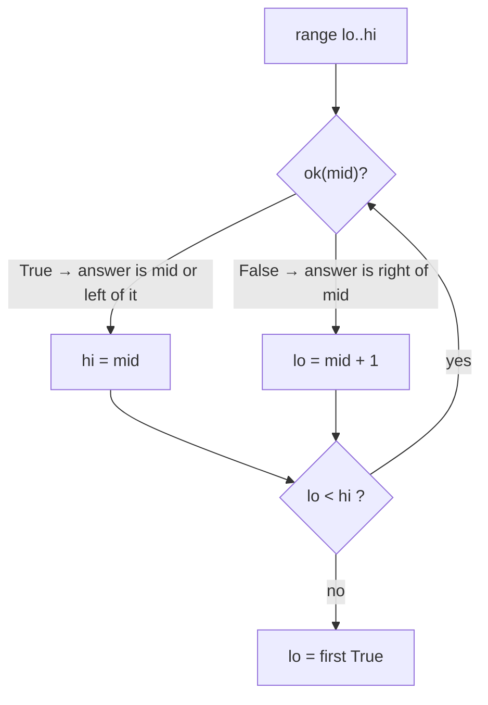

# 9 · Modified Binary Search

<div class="pattern-card" markdown>
**One-liner:** If you can look at the middle and **rule out half** of what's left, you can find the answer in O(log n), even when the array isn't plainly sorted.

**Typical cost:** <span class="cx time">O(log n)</span> <span class="cx space">O(1)</span>

**⏱ Study time:** ~10 min
</div>

## Recognise it

!!! tip "Trigger phrases"
    - Input is **sorted**, or **rotated** sorted, or "mountain"/bitonic
    - "find in **O(log n)**", "first / last position of", "insert position"
    - "**minimum** speed / capacity / days such that …": a monotone yes/no question over a range of answers
    - Constraints like `n ≤ 10⁹`, which rule out a linear scan of the answer range

## The picture

Each step looks at `M` and throws away half the range:

<div class="arr-label">search 9 in sorted nums</div>
<div class="arr"><span>-1</span><span>0</span><span>3</span><span class="hi">5</span><span class="win">9</span><span class="win">12</span></div>
<div class="arr ptr"><span>L</span><span></span><span></span><span>M</span><span></span><span>R</span></div>
<div class="arr-label">5 &lt; 9 → discard left half, L = M + 1</div>
<div class="arr"><span class="dim">-1</span><span class="dim">0</span><span class="dim">3</span><span class="dim">5</span><span class="hi">9</span><span>12</span></div>
<div class="arr ptr"><span></span><span></span><span></span><span></span><span>L M</span><span>R</span></div>

The general idea is that binary search finds the **boundary** in a monotone yes/no sequence:

<div class="arr-label">ok(x) for x = 1, 2, 3, …: find the first True</div>
<div class="arr"><span class="dim">F</span><span class="dim">F</span><span class="dim">F</span><span class="hi">T</span><span class="win">T</span><span class="win">T</span><span class="win">T</span></div>



!!! note "Variants"
    - **Search on index**: find a value or position in an array (704, 33, 34).
    - **Search on answer**: the array is the *range of possible answers*. You binary-search the smallest answer that passes a monotone `ok()` check (875, 1011, 410).
    - Python ships the index version: `bisect.bisect_left(a, x)` (lower bound) and `bisect.bisect_right(a, x)` (upper bound).

## The template

The one template to memorise is the **lower bound**, the first index where `ok` turns True:

```python
--8<-- "src/patterns/modified_binary_search.py:template"
```

## Why this complexity?

| Step | Cost | Why |
|---|---|---|
| Each iteration | <span class="cx time">O(1)</span> × check | one comparison (or one `ok()` call) |
| Iterations | <span class="cx time">O(log n)</span> | n → n/2 → n/4 → … → 1 takes log₂ n halvings |
| Search on answer | <span class="cx time">O(log R · C)</span> | R = size of the answer range, C = cost of one `ok()` check |
| Memory | <span class="cx space">O(1)</span> | just `lo`, `hi`, `mid` (iterative) |

**Rule of thumb:** *halving the search space each step gives O(log n).* A billion candidates takes only about **30 steps**. Whenever a check is monotone (once it's true it stays true), you can binary-search it.

## Worked problems

=== "704 · Binary Search"

    **Problem:** return the index of `target` in a sorted array, or −1.

    **Insight:** classic closed interval `[lo, hi]`. Stop on a hit, otherwise drop the half that can't contain the target.

    ```python
    --8<-- "src/patterns/modified_binary_search.py:binary_search"
    ```

    <span class="cx time">O(log n)</span> <span class="cx space">O(1)</span>. A linear scan is O(n).

=== "33 · Search in Rotated Sorted Array"

    **Problem:** a sorted array has been rotated (e.g. `[4,5,6,7,0,1,2]`). Find `target` in O(log n).

    **Insight:** split at `mid` and **one half is always sorted**. Check whether the target falls inside the sorted half's range. If it does, go there. Otherwise go to the other half.

    ```python
    --8<-- "src/patterns/modified_binary_search.py:rotated"
    ```

    <span class="cx time">O(log n)</span> <span class="cx space">O(1)</span>

=== "875 · Koko Eating Bananas"

    **Problem:** find the minimum eating speed so all piles are finished within `h` hours.

    **Insight:** binary-search the **answer** (speed in `1..max(piles)`). "Can finish at speed s" is monotone: if s works, so does every faster speed.

    ```python
    --8<-- "src/patterns/modified_binary_search.py:koko"
    ```

    <span class="cx time">O(n log m)</span> <span class="cx space">O(1)</span>, with m = max pile. Trying every speed is O(n·m).

## Pitfalls

- **Infinite loops:** with `lo < hi` and `hi = mid`, you **must** use `lo = mid + 1` (never `lo = mid`), or the range may never shrink.
- **Mixing interval styles:** closed `[lo, hi]` pairs with `while lo <= hi` and `hi = mid - 1`. Half-open `[lo, hi)` pairs with `while lo < hi` and `hi = mid`. Pick one and stick with it.
- **Rotated + duplicates** (LeetCode 81): `nums[lo] == nums[mid]` tells you nothing, so shrink `lo += 1`. The worst case becomes O(n).

## Recall card

??? question "State the lower-bound loop from memory."
    `while lo < hi: mid = (lo+hi)//2; if ok(mid): hi = mid else: lo = mid + 1`, then return `lo`.

??? question "How do you spot 'binary search on the answer'?"
    The question asks for a **minimum/maximum value** satisfying a condition, and checking a given value is easy and **monotone**. Search the value range, not the array.

## Practice

- [704. Binary Search](https://leetcode.com/problems/binary-search/)
- [33. Search in Rotated Sorted Array](https://leetcode.com/problems/search-in-rotated-sorted-array/)
- [34. Find First and Last Position of Element in Sorted Array](https://leetcode.com/problems/find-first-and-last-position-of-element-in-sorted-array/)
- [875. Koko Eating Bananas](https://leetcode.com/problems/koko-eating-bananas/)
