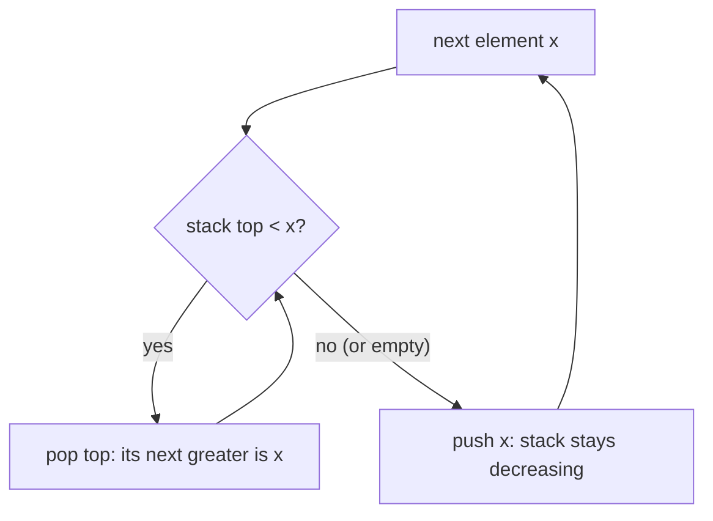

# 6 · Monotonic Stack

<div class="pattern-card" markdown>
**One-liner:** Keep a stack whose values are always sorted (e.g. decreasing). When a new element **breaks the order**, pop everything it beats. Each popped element has just found its *next greater* (or smaller) element.

**Typical cost:** <span class="cx time">O(n)</span> <span class="cx space">O(n)</span>

**⏱ Study time:** ~10 min
</div>

## Recognise it

!!! tip "Trigger phrases"
    - "**next greater** / next smaller element"
    - "**previous** greater / smaller element"
    - "how many days until a **warmer** temperature?"
    - "**largest rectangle** in a histogram", "trapping rain water", "maximal rectangle"
    - "stock span", "remove k digits to make the **smallest** number"
    - For every element you need the **nearest** element to its left/right that is bigger/smaller

**Variants:** **decreasing stack** → finds next **greater**; **increasing stack** → finds next **smaller**. Iterate right-to-left (or read the stack top before pushing) to get the *previous* greater/smaller instead.

## The picture

`nums = [2, 1, 2, 4, 3]`, decreasing stack. People in a queue waiting for someone taller to arrive:

<div class="arr"><span>2</span><span>1</span><span>2</span><span class="hi">4</span><span>3</span></div>
<div class="arr ptr"><span></span><span></span><span></span><span>i</span><span></span></div>

| i | x | pops (they found their answer = x) | stack after (values) |
|---|---|---|---|
| 0 | 2 | — | `[2]` |
| 1 | 1 | — | `[2, 1]` |
| 2 | 2 | `1 → 2` | `[2, 2]` |
| 3 | 4 | `2 → 4`, `2 → 4` | `[4]` |
| 4 | 3 | — | `[4, 3]` |

Leftovers (`4`, `3`) never found a greater element, so their answer is `-1`. Result: `[4, 2, 4, -1, -1]`.



## The template

```python
--8<-- "src/patterns/monotonic_stack.py:template"
```

## Why this complexity?

| Step | Cost | Why |
|---|---|---|
| Pushes | <span class="cx time">O(n)</span> | every index is pushed exactly once |
| Pops | <span class="cx time">O(n)</span> total | every index is popped **at most once**; you can't pop more than you pushed |
| Per element | <span class="cx time">O(1)</span> amortized | a single step may pop many, but the total over the run is bounded by n |
| Memory | <span class="cx space">O(n)</span> | worst case (strictly decreasing input) nothing is ever popped |

**Rule of thumb:** *each element is pushed once and popped once, so 2n operations in total: O(n) amortized,* even though there's a `while` inside a `for`. The brute force scans right from every element: O(n²).

## Worked problems

=== "739 · Daily Temperatures"

    **Problem:** for each day, how many days until a warmer one (0 if never)?

    **Insight:** next-greater, but store **indices** so the answer is the distance `i − j`.

    ```python
    --8<-- "src/patterns/monotonic_stack.py:daily_temperatures"
    ```

    <span class="cx time">O(n)</span> <span class="cx space">O(n)</span>, vs. O(n²) scanning forward from each day.

=== "496 · Next Greater Element I"

    **Problem:** `nums1 ⊆ nums2` (distinct values); for each `x` in `nums1`, find its next greater in `nums2`.

    **Insight:** run the template over `nums2` once, record answers in a hash map, then look up each `nums1` value.

    ```python
    --8<-- "src/patterns/monotonic_stack.py:next_greater_element"
    ```

    <span class="cx time">O(n + m)</span> <span class="cx space">O(n)</span>, vs. O(n·m) brute force.

=== "84 · Largest Rectangle in Histogram"

    **Problem:** area of the largest rectangle that fits under the bars.

    **Insight:** **increasing** stack. When bar `i` is shorter than the top, the top bar can't extend further right. Its rectangle spans from just after the new stack top (its previous smaller) to `i − 1` (its next smaller). A sentinel `0` at the end flushes everything.

    ```python
    --8<-- "src/patterns/monotonic_stack.py:largest_rectangle"
    ```

    <span class="cx time">O(n)</span> <span class="cx space">O(n)</span>, vs. O(n²) expanding left/right from each bar.

## Pitfalls

- **Values vs. indices:** push indices whenever you need distances or widths (739, 84). Values suffice only when they're unique and you just need the value (496).
- **Strict vs. non-strict comparison:** `<` vs. `<=` decides how equal elements are treated. Next *strictly* greater needs `stack top < x`.
- **Forgetting leftovers:** elements still on the stack at the end never found an answer. Initialise the result with the default (`-1` / `0`) or flush with a sentinel.
- **Wrong monotonic direction:** next **greater** needs a **decreasing** stack; next **smaller** needs an **increasing** one.

## Recall card

??? question "Why is it O(n) when there's a while loop inside the for loop?"
    Amortized analysis. Each index is pushed once and popped at most once, so all the inner-loop iterations **across the whole run** add up to ≤ n.

??? question "Next greater: increasing or decreasing stack?"
    **Decreasing.** The stack holds elements still waiting for something bigger. A bigger newcomer pops (answers) all the smaller ones on top.

## Practice

- [739. Daily Temperatures](https://leetcode.com/problems/daily-temperatures/)
- [496. Next Greater Element I](https://leetcode.com/problems/next-greater-element-i/)
- [503. Next Greater Element II](https://leetcode.com/problems/next-greater-element-ii/) (circular, so loop twice)
- [84. Largest Rectangle in Histogram](https://leetcode.com/problems/largest-rectangle-in-histogram/)
