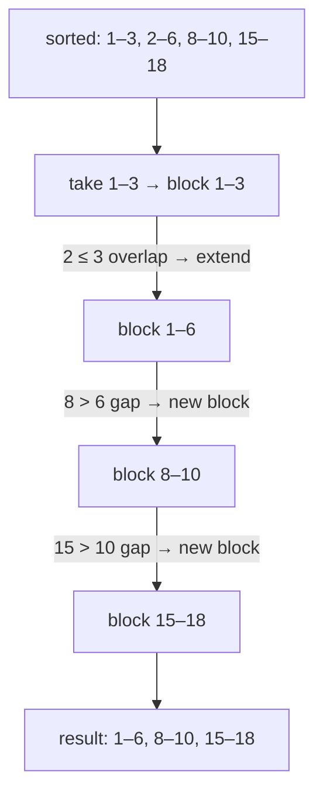
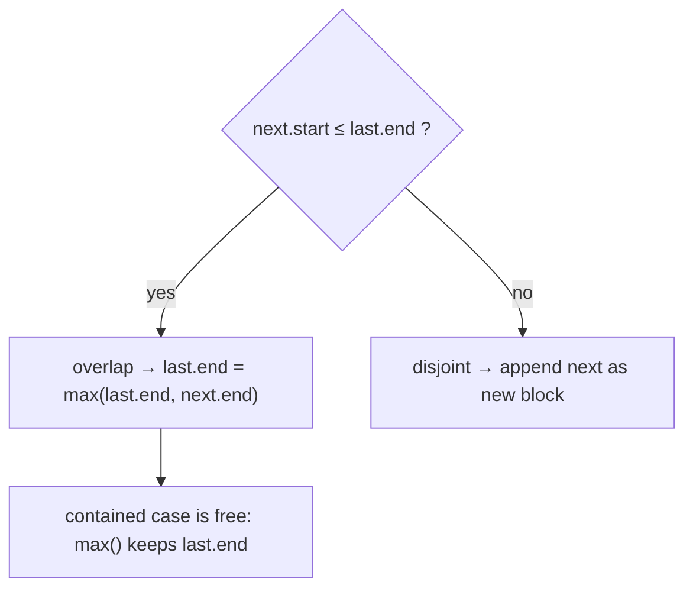

# 8 · Overlapping Intervals

<div class="pattern-card" markdown>
**One-liner:** Sort by start (or end), then sweep left to right. Each interval either **extends** the current block or **starts a new one**.

**Typical cost:** <span class="cx time">O(n log n)</span> <span class="cx space">O(n)</span>

**⏱ Study time:** ~8 min
</div>

## Recognise it

!!! tip "Trigger phrases"
    - Input is a list of `[start, end]` pairs: meetings, bookings, ranges
    - "**merge** overlapping", "**insert** an interval", "**minimum removals** so none overlap"
    - "can one person attend all meetings?", "how many **rooms** are needed?"

## The picture

Two intervals `a` and `b` (with `a.start ≤ b.start`) overlap exactly when **`b.start ≤ a.end`**. Once they're sorted, you only ever compare against the **last** merged block:

<div class="arr-label">sorted by start</div>
<div class="arr"><span class="win">1–3</span><span class="win">2–6</span><span>8–10</span><span class="hi">15–18</span></div>
<div class="arr-label">merged</div>
<div class="arr"><span class="win">1–6</span><span>8–10</span><span class="hi">15–18</span></div>



The three ways an interval can relate to the current block:



## The template

```python
--8<-- "src/patterns/overlapping_intervals.py:template"
```

## Why this complexity?

| Step | Cost | Why |
|---|---|---|
| Sort | <span class="cx time">O(n log n)</span> | puts every possible overlap next to each other |
| Sweep | <span class="cx time">O(n)</span> | one comparison with the last block per interval |
| Output | <span class="cx space">O(n)</span> | the merged list (sort itself is O(n) in Python's Timsort) |
| Already sorted input (57) | <span class="cx time">O(n)</span> | no sort needed, just one sweep |

**Rule of thumb:** *the sort dominates.* An interval problem is O(n log n) because of sorting. The sweep after it is linear. Without sorting, you'd compare every pair: **O(n²)**.

**Sort by what?** Sort by **start** to *merge or insert*. Sort by **end** for *greedy selection* (keep as many as possible / remove fewest), because the interval that finishes first leaves the most room.

## Worked problems

=== "56 · Merge Intervals"

    **Problem:** merge all overlapping intervals.

    **Insight:** this is the template. Sort by start, then extend or append.

    ```python
    --8<-- "src/patterns/overlapping_intervals.py:template"
    ```

    <span class="cx time">O(n log n)</span> <span class="cx space">O(n)</span>. Pairwise checking is O(n²).

=== "57 · Insert Interval"

    **Problem:** insert `new` into a **sorted, non-overlapping** list and merge where needed.

    **Insight:** the input is already sorted, so skip the sort. Do three phases: copy everything **before**, **absorb** everything overlapping, copy everything **after**.

    ```python
    --8<-- "src/patterns/overlapping_intervals.py:insert_interval"
    ```

    <span class="cx time">O(n)</span> <span class="cx space">O(n)</span>. Appending and re-merging would be O(n log n).

=== "435 · Non-overlapping Intervals"

    **Problem:** minimum number of intervals to remove so the rest don't overlap.

    **Insight:** greedy. Sort by **end** and keep whatever finishes earliest. Each overlap costs one removal: drop the one that ends later.

    ```python
    --8<-- "src/patterns/overlapping_intervals.py:non_overlapping"
    ```

    <span class="cx time">O(n log n)</span> <span class="cx space">O(1)</span> extra (beyond the sort).

## Pitfalls

- **Touching endpoints:** is `[1,4]` + `[4,5]` an overlap? In 56 yes (`<=`). In 435 no (`>=` means it fits). Read the statement and choose `<` or `<=` on purpose.
- **Forgetting `max()` on extend:** `[1,10]` followed by `[2,3]` must stay `[1,10]`, not shrink to `[1,3]`.
- **Sorting by the wrong key:** greedy max-selection by *start* fails on one long early interval. Sort by *end*.

## Recall card

??? question "What's the overlap test after sorting by start?"
    `next.start <= last.end`. If true, `last.end = max(last.end, next.end)`. Otherwise append `next`.

??? question "Why is it O(n log n), and when is it O(n)?"
    The sort is O(n log n) and the sweep is O(n). If the input is **already sorted** (as in Insert Interval), it's a single O(n) sweep.

## Practice

- [56. Merge Intervals](https://leetcode.com/problems/merge-intervals/)
- [57. Insert Interval](https://leetcode.com/problems/insert-interval/)
- [435. Non-overlapping Intervals](https://leetcode.com/problems/non-overlapping-intervals/)
- [253. Meeting Rooms II](https://leetcode.com/problems/meeting-rooms-ii/) (sort + min-heap of end times)
