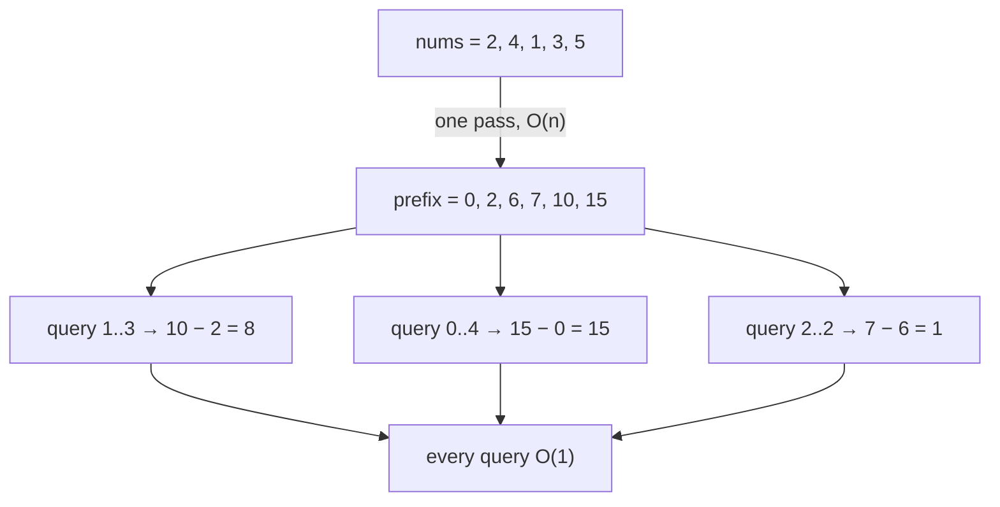

# 1 · Prefix Sum

<div class="pattern-card" markdown>
**One-liner:** Pay O(n) once to precompute running totals, then answer *any* range-sum question in O(1).

**Typical cost:** <span class="cx time">O(n) build · O(1) query</span> <span class="cx space">O(n)</span>

**⏱ Study time:** ~8 min
</div>

## Recognise it

!!! tip "Trigger phrases"
    - "sum of elements between index *i* and *j*", asked **many times**
    - "number of subarrays whose sum equals *k*"
    - "longest subarray with equal 0s and 1s" (any **balance** you can turn into a sum)
    - The array is **static**: queries come in, but nothing changes in between

## The picture

Each prefix cell holds the sum of **everything to its left**. A range sum is just *right edge minus left edge*:

<div class="arr-label">nums</div>
<div class="arr"><span>2</span><span class="win">4</span><span class="win">1</span><span class="win">3</span><span>5</span></div>
<div class="arr-label">prefix (one extra leading 0)</div>
<div class="arr"><span>0</span><span class="hi">2</span><span>6</span><span>7</span><span class="hi">10</span><span>15</span></div>

`sum(nums[1..3]) = prefix[4] − prefix[1] = 10 − 2 = 8` ✅



!!! note "The upgrade: prefix sum + hash map"
    If the question is *"how many / how long are subarrays with sum = k"*, you don't need a range query at all.
    Walk once, keeping a **running sum**. A subarray `(j, i]` sums to `k` exactly when
    `prefix[i] − prefix[j] = k`, i.e. when you've **seen** `running − k` before. Store the prefixes you've seen in a hash map.

## The template

```python
--8<-- "src/patterns/prefix_sum.py:template"
```

## Why this complexity?

| Step | Cost | Why |
|---|---|---|
| Build `prefix` | <span class="cx time">O(n)</span> | one pass, each cell = previous cell + one number |
| One query | <span class="cx time">O(1)</span> | two lookups and a subtraction |
| *q* queries | <span class="cx time">O(n + q)</span> | vs. **O(n·q)** if you re-sum the range every time |
| Memory | <span class="cx space">O(n)</span> | the prefix array (or the hash map in the upgraded variant) |

**Rule of thumb:** *preprocessing trades space for time.* Whenever you'd otherwise recompute the same partial result inside a loop, precompute it once.

## Worked problems

=== "303 · Range Sum Query"

    **Problem:** many `sumRange(left, right)` calls on a fixed array.

    **Insight:** the textbook use: build once, answer each query in O(1).

    ```python
    --8<-- "src/patterns/prefix_sum.py:range_sum_query"
    ```

    <span class="cx time">O(n) init, O(1) query</span> <span class="cx space">O(n)</span>

=== "560 · Subarray Sum Equals K"

    **Problem:** count contiguous subarrays summing to `k` (negatives allowed, so sliding window **won't** work).

    **Insight:** prefix sum + hash map: count how often `running − k` has appeared before.

    ```python
    --8<-- "src/patterns/prefix_sum.py:subarray_sum_k"
    ```

    <span class="cx time">O(n)</span> <span class="cx space">O(n)</span>, down from the brute-force O(n²) over all `(i, j)` pairs.

=== "525 · Contiguous Array"

    **Problem:** longest subarray with equally many 0s and 1s.

    **Insight:** map `0 → −1`, `1 → +1`. "Equal counts" becomes "sum = 0", so the same balance seen twice brackets a valid subarray. Store the **earliest** index of each balance to maximise length.

    ```python
    --8<-- "src/patterns/prefix_sum.py:contiguous_array"
    ```

    <span class="cx time">O(n)</span> <span class="cx space">O(n)</span>

## Pitfalls

- **Off-by-one:** use the `len(nums) + 1` layout with `prefix[0] = 0`; then `sum(i..j) = prefix[j+1] − prefix[i]` with no special cases.
- **Forgetting `seen[0] = 1`** (or `{0: -1}`): without it you miss subarrays that start at index 0.
- **Mutable arrays:** if values change between queries, a plain prefix array is O(n) per update. You'd need a Fenwick/segment tree (beyond these 15 patterns).

## Recall card

??? question "Close your eyes: what are the two formulas?"
    `prefix[i+1] = prefix[i] + nums[i]` and `sum(i..j) = prefix[j+1] − prefix[i]`.
    For counting: `count += seen[running − k]` **before** `seen[running] += 1`.

??? question "Sliding window or prefix sum for 'subarray sum = k'?"
    Sliding window only works when all numbers are **non-negative** (the sum grows monotonically as the window grows). With negatives, use **prefix sum + hash map**.

## Practice

- [303. Range Sum Query – Immutable](https://leetcode.com/problems/range-sum-query-immutable/)
- [525. Contiguous Array](https://leetcode.com/problems/contiguous-array/)
- [560. Subarray Sum Equals K](https://leetcode.com/problems/subarray-sum-equals-k/)
- [238. Product of Array Except Self](https://leetcode.com/problems/product-of-array-except-self/) (prefix *products*)
