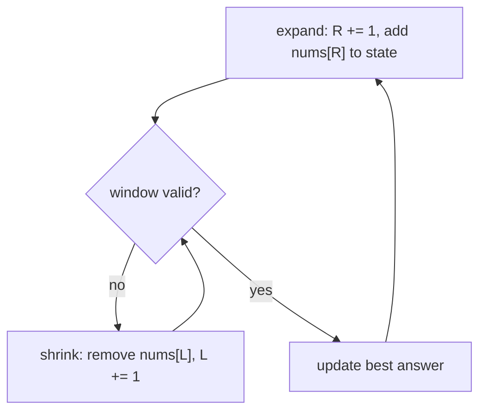

# 3 · Sliding Window

<div class="pattern-card" markdown>
**One-liner:** Keep a contiguous window `[left, right]` and update its state **incrementally** as it slides: add what enters, remove what leaves. Never recompute the whole window.

**Typical cost:** <span class="cx time">O(n)</span> <span class="cx space">O(1) or O(k)</span> (k = alphabet / distinct items tracked)

**⏱ Study time:** ~10 min
</div>

## Recognise it

!!! tip "Trigger phrases"
    - "**contiguous** subarray / substring"
    - "longest / shortest / maximum / minimum … **window**"
    - "of size **k**" (fixed window)
    - "at most *k* distinct", "without repeating characters", "contains all characters of *t*" (variable window)
    - Validity is **monotonic**: shrinking a valid window keeps it valid (or growing an invalid one keeps it invalid)

**Variants:** **fixed size** (both edges move together) and **variable size** (expand `right` every step, shrink `left` while the window is invalid).

## The picture

**Fixed window, k = 3:** slide by one; add the newcomer, subtract the leaver:

<div class="arr-label">window sum = 2 + 1 + 5 = 8</div>
<div class="arr"><span class="win">2</span><span class="win">1</span><span class="win">5</span><span>1</span><span>3</span><span>2</span></div>
<div class="arr-label">slide: 8 − 2 + 1 = 7 (one subtraction, one addition)</div>
<div class="arr"><span class="dim">2</span><span class="win">1</span><span class="win">5</span><span class="hi">1</span><span>3</span><span>2</span></div>
<div class="arr-label">slide: 7 − 1 + 3 = 9 ✅ max</div>
<div class="arr"><span class="dim">2</span><span class="dim">1</span><span class="win">5</span><span class="win">1</span><span class="hi">3</span><span>2</span></div>

**Variable window:** longest substring without repeats in `"abcabcbb"`; `R` expands, `L` jumps when a duplicate enters:

<div class="arr"><span class="win">a</span><span class="win">b</span><span class="win">c</span><span class="hi">a</span><span>b</span><span>c</span><span>b</span><span>b</span></div>
<div class="arr ptr"><span>L</span><span></span><span></span><span>R</span><span></span><span></span><span></span><span></span></div>
<div class="arr-label">'a' repeats, so L jumps past the old 'a'</div>
<div class="arr"><span class="dim">a</span><span class="win">b</span><span class="win">c</span><span class="win">a</span><span>b</span><span>c</span><span>b</span><span>b</span></div>
<div class="arr ptr"><span></span><span>L</span><span></span><span>R</span><span></span><span></span><span></span><span></span></div>



## The template

```python
--8<-- "src/patterns/sliding_window.py:template"
```

## Why this complexity?

| Step | Cost | Why |
|---|---|---|
| `right` moves | <span class="cx time">O(n)</span> | once per element |
| `left` moves | <span class="cx time">O(n)</span> total | it only goes forward and never passes `right`, so ≤ n moves **over the whole run** |
| Window update | <span class="cx time">O(1)</span> | add one, remove one, with no re-summing |
| Memory | <span class="cx space">O(1) / O(k)</span> | a running sum, or a hash map of counts bounded by the alphabet / distinct values |

**Rule of thumb:** *the nested `while` looks like O(n²), but each element enters the window once and leaves once, so it's 2n operations: O(n).* That's an **amortized** argument: count total pointer moves, not loop nesting.

## Worked problems

=== "643 · Max Average Subarray I"

    **Problem:** maximum average of any contiguous subarray of length `k`.

    **Insight:** fixed window. Keep a running sum; the max average is the max sum divided by `k`.

    ```python
    --8<-- "src/patterns/sliding_window.py:max_average"
    ```

    <span class="cx time">O(n)</span> <span class="cx space">O(1)</span>, vs. O(n·k) re-summing each window.

=== "3 · Longest Substring Without Repeating"

    **Problem:** length of the longest substring with all distinct characters.

    **Insight:** variable window. Remember each char's last index; when it repeats **inside** the window, jump `left` past it.

    ```python
    --8<-- "src/patterns/sliding_window.py:longest_unique"
    ```

    <span class="cx time">O(n)</span> <span class="cx space">O(min(n, Σ))</span> where Σ = alphabet size, vs. O(n³) checking all substrings.

=== "76 · Minimum Window Substring"

    **Problem:** smallest window of `s` containing every character of `t` (with multiplicity).

    **Insight:** expand until valid (`missing == 0`), then shrink from the left while it stays valid, recording the smallest. A **shortest-window** problem shrinks inside the valid state; a **longest-window** problem shrinks out of the invalid state.

    ```python
    --8<-- "src/patterns/sliding_window.py:min_window"
    ```

    <span class="cx time">O(|s| + |t|)</span> <span class="cx space">O(Σ)</span>, vs. O(|s|²·Σ) for checking every substring.

## Pitfalls

- **Negative numbers break "sum ≤ limit" windows:** shrinking no longer reliably lowers the sum. Use [prefix sum + hash map](prefix-sum.md) instead.
- **Stale `last_seen`:** in problem 3, only jump if the previous index is **≥ left**. Otherwise `"abba"` moves `left` backwards.
- **Window length is `right − left + 1`**, not `right − left`.
- **Where you record the answer:** longest → after shrinking (window is valid); shortest → inside the shrink loop (while still valid).

## Recall card

??? question "Why is the nested while loop still O(n)?"
    `left` only increases and never exceeds `right`. Across the whole run it moves at most n times, so the total work of all inner loops combined is O(n) and the overall cost is O(2n) = O(n).

??? question "Sliding window vs. two pointers: what's the difference?"
    Sliding window is a same-direction two-pointer technique where you care about **everything between** the pointers (the window's contents). Classic two pointers usually only looks at the two **elements** under the pointers.

## Practice

- [643. Maximum Average Subarray I](https://leetcode.com/problems/maximum-average-subarray-i/)
- [3. Longest Substring Without Repeating Characters](https://leetcode.com/problems/longest-substring-without-repeating-characters/)
- [424. Longest Repeating Character Replacement](https://leetcode.com/problems/longest-repeating-character-replacement/)
- [76. Minimum Window Substring](https://leetcode.com/problems/minimum-window-substring/)
