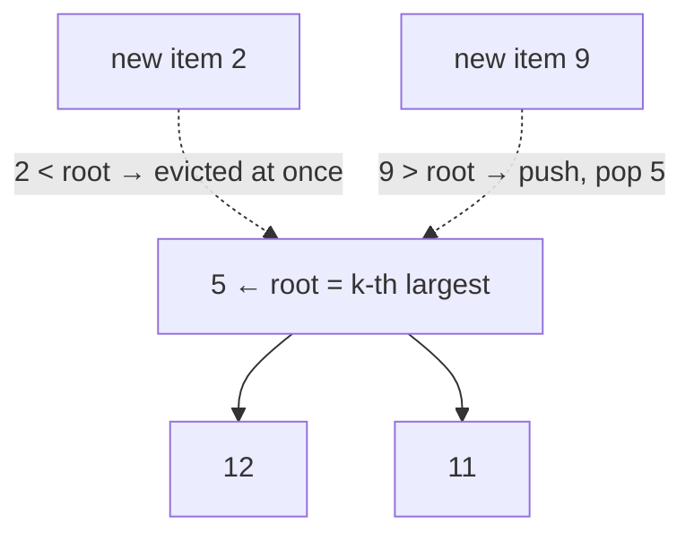

# 7 · Top-K Elements

<div class="pattern-card" markdown>
**One-liner:** Keep a heap of only **k** items. Every new item has to beat the weakest member (the heap root) to get in.

**Typical cost:** <span class="cx time">O(n log k)</span> <span class="cx space">O(k)</span>

**⏱ Study time:** ~9 min
</div>

## Recognise it

!!! tip "Trigger phrases"
    - "**k-th** largest / smallest", "**top k**", "**k most** frequent", "**k closest**"
    - You need *some* of the extremes, not a fully sorted output
    - Streaming input: "find the k-th largest **so far**" (LeetCode 703)

## The picture

To keep the **k largest**, use a **min-heap** of size k. The root is the *smallest of the winners*, the bouncer at the door. Anything smaller than the root is ignored.

<div class="arr-label">stream, k = 3</div>
<div class="arr"><span class="win">3</span><span class="dim">1</span><span class="win">5</span><span class="win">12</span><span class="dim">2</span><span class="win">11</span></div>
<div class="arr-label">final min-heap (array form): root = 3rd largest</div>
<div class="arr"><span class="hi">5</span><span>12</span><span>11</span></div>



!!! note "Python's `heapq` is a **min-heap** only"
    - k **largest** → min-heap of size k (pop the smallest when it overflows).
    - k **smallest** / k **closest** → you want a *max*-heap of size k, so **push negated keys** (`-dist`).
    - Tuples compare element by element: `(priority, value)` pairs give you keyed heaps for free.

## The template

```python
--8<-- "src/patterns/top_k_elements.py:template"
```

## Why this complexity?

| Approach | Time | Space | Why |
|---|---|---|---|
| Sort everything, take k | <span class="cx time">O(n log n)</span> | <span class="cx space">O(n)</span> | orders all n items, but you only needed k |
| Heap of size **k** | <span class="cx time">O(n log k)</span> | <span class="cx space">O(k)</span> | n pushes/pops, each costs log(heap size) = log k |
| Heapify all n, pop k | <span class="cx time">O(n + k log n)</span> | <span class="cx space">O(n)</span> | `heapify` is linear; good when k ≪ n and you can hold all n |
| Bucket sort (frequencies) | <span class="cx time">O(n)</span> | <span class="cx space">O(n)</span> | counts are bounded by n, so they index an array |
| Quickselect | <span class="cx time">O(n) avg, O(n²) worst</span> | <span class="cx space">O(1)</span> | partitions like quicksort but recurses into one side only |

**Rule of thumb:** *a heap operation costs log of the heap's size, so keep the heap small.* Capping it at k turns `log n` into `log k`. When k is a constant, that is effectively **O(n)**.

## Worked problems

=== "215 · Kth Largest Element"

    **Problem:** return the k-th largest element of an unsorted array.

    **Insight:** min-heap of size k. After the pass, the root *is* the k-th largest.

    ```python
    --8<-- "src/patterns/top_k_elements.py:kth_largest"
    ```

    <span class="cx time">O(n log k)</span> <span class="cx space">O(k)</span>. Sorting is O(n log n). Shortcut: `heapq.nlargest(k, nums)[-1]`.

=== "347 · Top K Frequent Elements"

    **Problem:** return the k most frequent values.

    **Insight:** count with `Counter`, then run the top-k heap over `(freq, value)` pairs.

    ```python
    --8<-- "src/patterns/top_k_elements.py:top_k_frequent"
    ```

    <span class="cx time">O(n log k)</span> <span class="cx space">O(n)</span> (the counter dominates).

    **Faster: bucket sort.** A frequency is at most n, so use it as an **array index**. No comparisons are needed.

    ```python
    --8<-- "src/patterns/top_k_elements.py:top_k_frequent_bucket"
    ```

    <span class="cx time">O(n)</span> <span class="cx space">O(n)</span>

=== "973 · K Closest Points to Origin"

    **Problem:** return the k points closest to `(0, 0)`.

    **Insight:** "k **smallest** distances" needs a **max**-heap of size k, so push `-distance`. Squared distance is enough; skip the `sqrt`.

    ```python
    --8<-- "src/patterns/top_k_elements.py:k_closest"
    ```

    <span class="cx time">O(n log k)</span> <span class="cx space">O(k)</span>. Sorting by distance is O(n log n).

## Pitfalls

- **Wrong heap direction:** k *largest* uses a **min**-heap; k *smallest* uses a **max**-heap (negated). It feels backwards, so remember the bouncer.
- **Uncomparable payloads:** `(priority, obj)` breaks on ties if `obj` can't be compared. Add a tiebreaker: `(priority, index, obj)`.
- **`heap[0]` is the min, not `heap[-1]`.** Only the root is ordered. The rest of the list isn't sorted.

## Recall card

??? question "Which heap for 'k largest', and what does the root mean?"
    A **min-heap** of size k. The root is the **k-th largest** so far: the smallest value still in the top k.

??? question "When does Top-K beat sorting, and when does it beat the heap?"
    The heap wins when k ≪ n: O(n log k) vs O(n log n). If values (or counts) are bounded integers, **bucket sort** gives O(n) with no heap at all.

## Practice

- [215. Kth Largest Element in an Array](https://leetcode.com/problems/kth-largest-element-in-an-array/)
- [347. Top K Frequent Elements](https://leetcode.com/problems/top-k-frequent-elements/)
- [973. K Closest Points to Origin](https://leetcode.com/problems/k-closest-points-to-origin/)
- [703. Kth Largest Element in a Stream](https://leetcode.com/problems/kth-largest-element-in-a-stream/)
