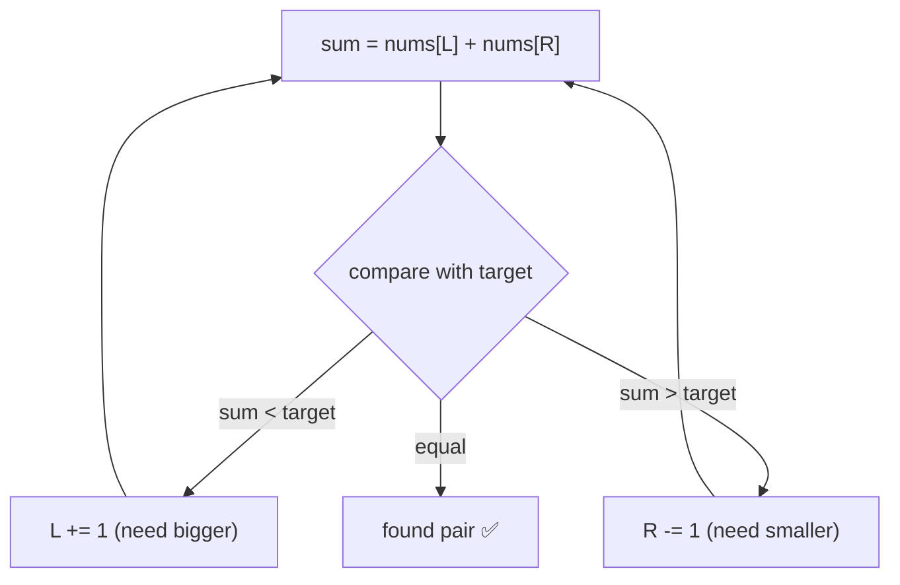

# 2 · Two Pointers

<div class="pattern-card" markdown>
**One-liner:** Two indices move through the array, each step **ruling out** a chunk of candidates, so a pair search that looks O(n²) becomes one linear sweep.

**Typical cost:** <span class="cx time">O(n)</span> <span class="cx space">O(1)</span> (plus O(n log n) if you have to sort first)

**⏱ Study time:** ~9 min
</div>

## Recognise it

!!! tip "Trigger phrases"
    - The input is **sorted** (or sorting it won't hurt the answer)
    - "find a **pair** / triplet that sums to *target*"
    - "**palindrome**", "reverse in place", "compare from both ends"
    - "remove duplicates / move zeros **in place**" with O(1) extra space
    - "maximise area / distance between two positions"

**Variants:** **opposite ends** (`L` from the left, `R` from the right, meeting in the middle) and **same direction** (a fast *read* pointer and a slow *write* pointer).

## The picture

**Opposite ends:** sorted `nums`, target `10`. The sum is too small, so `L` moves right; too big, so `R` moves left:

<div class="arr-label">step 1: 1 + 11 = 12 > 10, so move R left</div>
<div class="arr"><span class="hi">1</span><span>3</span><span>4</span><span>6</span><span>8</span><span class="hi">11</span></div>
<div class="arr ptr"><span>L</span><span></span><span></span><span></span><span></span><span>R</span></div>
<div class="arr-label">step 2: 1 + 8 = 9 < 10, so move L right</div>
<div class="arr"><span class="hi">1</span><span>3</span><span>4</span><span>6</span><span class="hi">8</span><span class="dim">11</span></div>
<div class="arr ptr"><span>L</span><span></span><span></span><span></span><span>R</span><span></span></div>
<div class="arr-label">step 4: 4 + 6 = 10 ✅ (grey cells are ruled out forever)</div>
<div class="arr"><span class="dim">1</span><span class="dim">3</span><span class="win">4</span><span class="win">6</span><span class="dim">8</span><span class="dim">11</span></div>
<div class="arr ptr"><span></span><span></span><span>L</span><span>R</span><span></span><span></span></div>



**Why moving is safe:** if `nums[L] + nums[R]` is too small, then `nums[L]` paired with **anything** left of `R` is even smaller, so `nums[L]` can never be part of the answer. Discard it.

## The template

```python
--8<-- "src/patterns/two_pointers.py:template"
```

## Why this complexity?

| Step | Cost | Why |
|---|---|---|
| Pointer moves | <span class="cx time">O(n)</span> | every iteration moves `L` or `R` one step closer; they meet after ≤ n steps |
| Optional sort | <span class="cx time">O(n log n)</span> | dominates if the input isn't sorted already |
| k-Sum (e.g. 3Sum) | <span class="cx time">O(n²)</span> | fix one element (n choices) × two-pointer scan (n) |
| Memory | <span class="cx space">O(1)</span> | just two indices (sorting in place may use O(log n) stack) |

**Rule of thumb:** *each pointer only ever moves forward (or only backward), at most n times in total, so the loop is O(n).* Two pointers replace the inner loop of a brute-force O(n²) pair search.

## Worked problems

=== "167 · Two Sum II (sorted)"

    **Problem:** sorted array, return 1-indexed positions of the two numbers that sum to `target`.

    **Insight:** pure opposite-ends template. Too small → `left += 1`; too big → `right -= 1`.

    ```python
    --8<-- "src/patterns/two_pointers.py:two_sum_sorted"
    ```

    <span class="cx time">O(n)</span> <span class="cx space">O(1)</span>, vs. O(n²) checking all pairs, or O(n) time **and** O(n) space with a hash map.

=== "15 · 3Sum"

    **Problem:** all unique triplets summing to 0.

    **Insight:** sort, then **fix** `nums[i]` and run Two Sum II on the rest for target `-nums[i]`. Skip equal neighbours to avoid duplicate triplets.

    ```python
    --8<-- "src/patterns/two_pointers.py:three_sum"
    ```

    <span class="cx time">O(n²)</span> <span class="cx space">O(1)</span> extra (ignoring output), vs. O(n³) for three nested loops.

=== "11 · Container With Most Water"

    **Problem:** choose two walls maximising `width × min(height)`.

    **Insight:** start with maximum width. The **shorter** wall caps the area, and moving the taller wall inward only shrinks width without raising the cap. So always move the shorter one.

    ```python
    --8<-- "src/patterns/two_pointers.py:container_water"
    ```

    <span class="cx time">O(n)</span> <span class="cx space">O(1)</span>, vs. O(n²) over all wall pairs.

## Pitfalls

- **Using it on unsorted data** for a pair-sum: the "move left/right" logic is only valid when order tells you which direction increases the sum. Sort first, or use a hash map.
- **`while left <= right`** for pairs: you'd pair an element with itself. Use `<`.
- **Duplicates in k-Sum:** skip equal values *after* moving, or you'll emit the same triplet several times.
- **Returning indices after sorting:** sorting destroys original positions. Store `(value, index)` pairs if indices matter.

## Recall card

??? question "What justifies discarding an element when you move a pointer?"
    Monotonicity. In a sorted array, if `nums[L] + nums[R] < target`, every partner of `nums[L]` (all ≤ `nums[R]`) also gives a sum < target, so `nums[L]` is useless. Same argument mirrored for `R`.

??? question "Opposite-ends vs. same-direction: when each?"
    **Opposite ends:** pair/sum/palindrome/area problems on sorted or symmetric data.
    **Same direction (read/write):** in-place filtering such as remove duplicates, move zeros, or partitioning.

## Practice

- [167. Two Sum II – Input Array Is Sorted](https://leetcode.com/problems/two-sum-ii-input-array-is-sorted/)
- [15. 3Sum](https://leetcode.com/problems/3sum/)
- [11. Container With Most Water](https://leetcode.com/problems/container-with-most-water/)
- [125. Valid Palindrome](https://leetcode.com/problems/valid-palindrome/)
