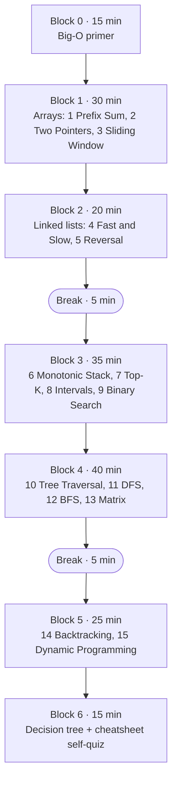

# Study Plan (2–3 h)

This plan takes you through all 15 patterns in about **2 h 40 min**, with two short breaks. The order is deliberate: each block builds on the one before it.

| Block | Time | Pages | Goal |
|---|---|---|---|
| 0 | 15 min | [Big-O primer](complexity/big-o-primer.md) | Read constraints → target complexity |
| 1 | 30 min | [Prefix Sum](patterns/prefix-sum.md), [Two Pointers](patterns/two-pointers.md), [Sliding Window](patterns/sliding-window.md) | The three O(n) array tricks |
| 2 | 20 min | [Fast & Slow](patterns/fast-slow-pointers.md), [In-place Reversal](patterns/linked-list-reversal.md) | O(1)-space pointer manipulation |
| ☕ | 5 min | | |
| 3 | 35 min | [Monotonic Stack](patterns/monotonic-stack.md), [Top-K](patterns/top-k-elements.md), [Intervals](patterns/overlapping-intervals.md), [Binary Search](patterns/modified-binary-search.md) | Choosing a data structure (stack, heap, sort, halving) |
| 4 | 40 min | [Tree Traversal](patterns/binary-tree-traversal.md), [DFS](patterns/depth-first-search.md), [BFS](patterns/breadth-first-search.md), [Matrix](patterns/matrix-traversal.md) | Visit everything once: O(V + E) |
| ☕ | 5 min | | |
| 5 | 25 min | [Backtracking](patterns/backtracking.md), [Dynamic Programming](patterns/dynamic-programming.md) | Exponential search, then memoise it down |
| 6 | 15 min | [Which Pattern?](which-pattern.md), [Cheatsheet](cheatsheet.md), [Complexity Map](complexity/pattern-complexity-map.md) | Retrieval practice |

## How to read each pattern page (~8–10 min)

1. **Recognise it** (1 min): memorise the trigger phrases. Recognising the pattern is most of the work.
2. **The picture** (2 min): look at the diagram until you could redraw it from memory.
3. **The template** (2 min): read it line by line, then try to write it on paper without looking.
4. **Why this complexity?** (1 min): say the rule of thumb out loud.
5. **Worked problems** (3 min): read the *Insight* line of each tab first; skim the code only after that.
6. **Recall card**: answer before you expand it.

!!! tip "Make it stick"
    - **Retrieval beats re-reading.** Next day, open the [cheatsheet](cheatsheet.md), cover the right-hand columns, and recall the complexity and template for each pattern.
    - **Spaced practice.** Solve one *Practice* problem per pattern over the next week: day 1 → patterns 1–5, day 2 → 6–9, day 3 → 10–13, day 4 → 14–15, day 7 → a random mix.
    - **Say the complexity out loud** every time you finish a problem, along with the reason for it ("each pointer moves at most n steps, so O(n)").
