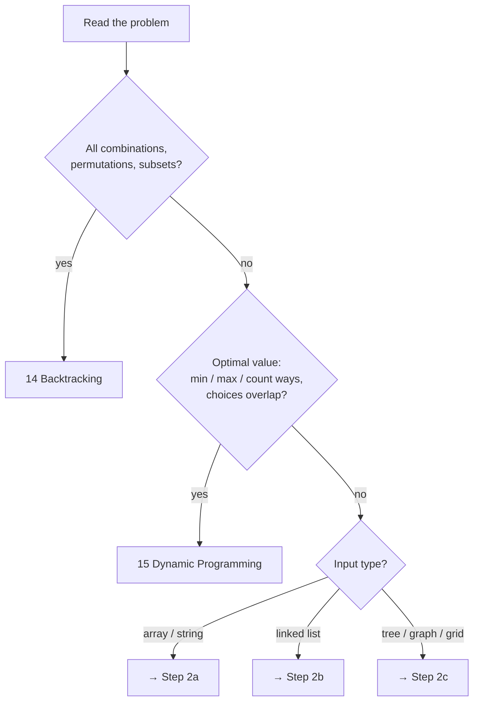
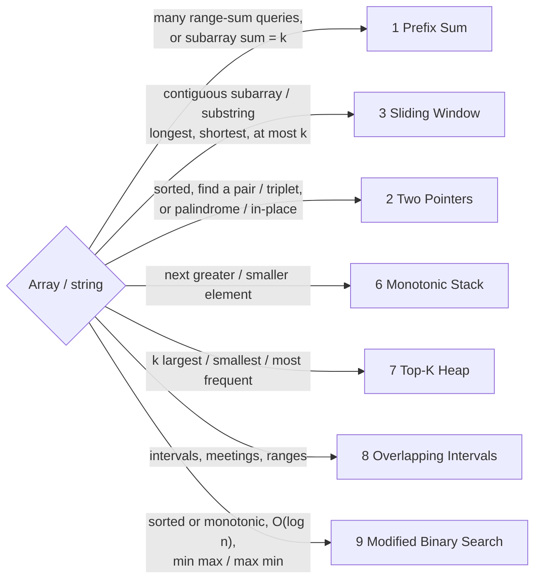
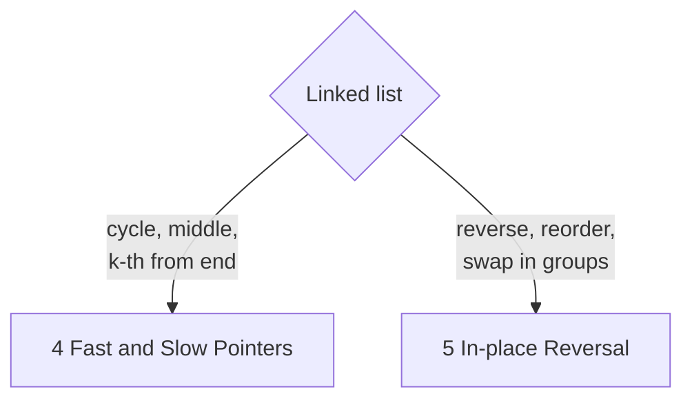
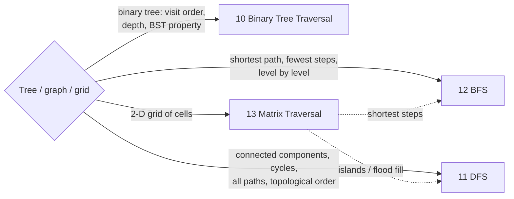

# Which Pattern? (Decision Tree)

Read the problem and ask these questions **in order**. The first diagram tells you which branch to follow, and the branch diagram names the pattern.

## Step 1 · What is the input, and what is asked?

## Step 2a · Array or string

## Step 2b · Linked list

## Step 2c · Tree, graph or grid

## Keyword lookup

| If the problem says… | Think | Complexity to aim for |
|---|---|---|
| "range sum", "sum of subarray equals k" | Prefix Sum | O(n) |
| "sorted array", "pair that sums to", "palindrome", "in-place" | Two Pointers | O(n) |
| "longest / shortest substring", "subarray of size k", "at most k distinct" | Sliding Window | O(n) |
| "cycle", "middle of list", "duplicate number in 1..n" | Fast & Slow | O(n), O(1) space |
| "reverse", "reorder list", "k-group" | In-place Reversal | O(n), O(1) space |
| "next greater", "warmer day", "histogram", "span" | Monotonic Stack | O(n) |
| "k-th largest", "top k", "k closest", "most frequent" | Top-K Heap | O(n log k) |
| "merge intervals", "meeting rooms", "overlap" | Intervals | O(n log n) |
| "sorted / rotated", "minimum speed / capacity such that…" | Binary Search | O(log n) or O(n log M) |
| "inorder", "level order", "depth", "BST" | Tree Traversal | O(n) |
| "connected", "provinces", "course schedule", "clone graph" | DFS | O(V + E) |
| "minimum steps", "shortest path" (unweighted), "spread" | BFS | O(V + E) |
| "grid", "islands", "flood fill", "spiral" | Matrix | O(R·C) |
| "all combinations", "generate", "n-queens" | Backtracking | O(2ⁿ) / O(n!) |
| "number of ways", "minimum cost", "longest increasing" | DP | O(states × work) |

!!! warning "Common confusions"
    - **Sliding window vs prefix sum:** a window needs **non-negative** numbers (or a monotone condition). With negatives, use prefix sum + hash map.
    - **BFS vs DFS:** both are O(V + E). Use **BFS when the answer is a distance**, DFS when you need to explore or check connectivity.
    - **Backtracking vs DP:** if the same sub-call `f(i, state)` repeats, add memoisation, which turns the backtracking solution into DP. If the task is to *list* every solution, it stays backtracking.
    - **Heap vs sort:** sorting costs O(n log n). A size-k heap costs O(n log k), which wins when k ≪ n.
